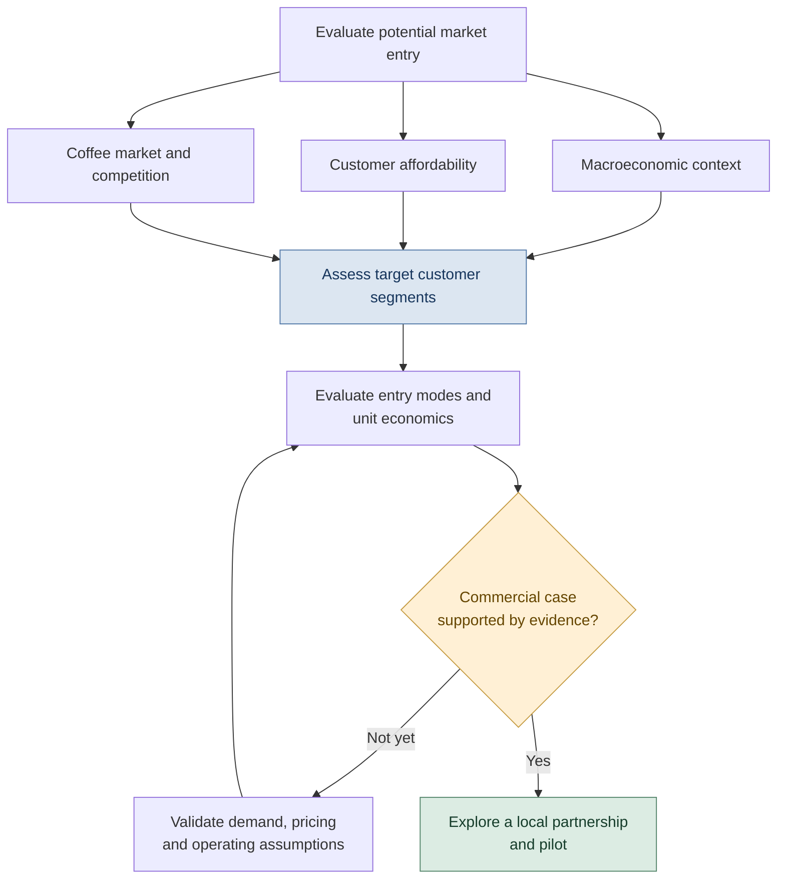
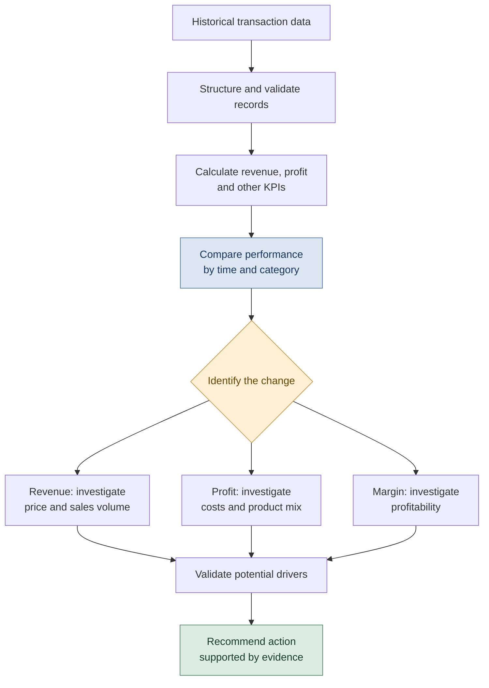
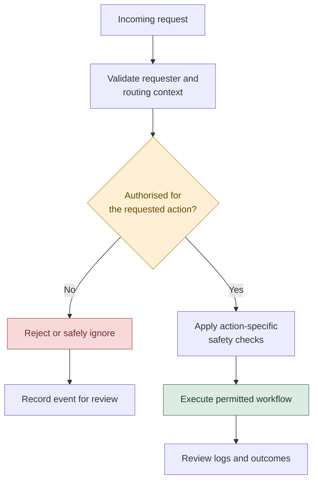
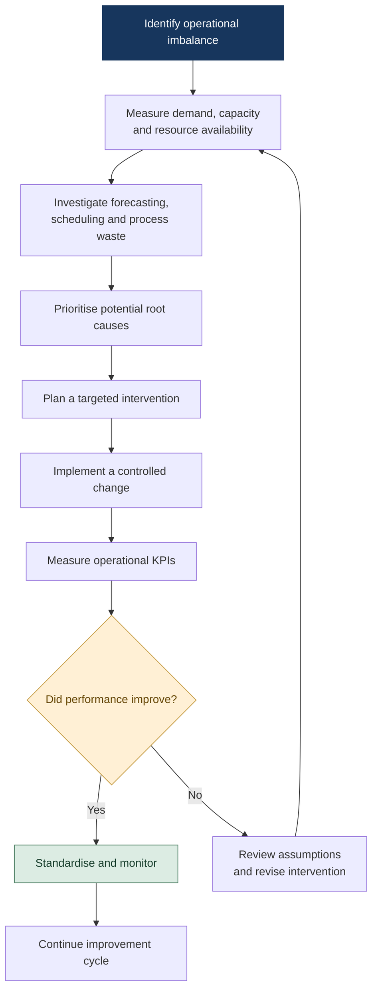

# Subash Gauchan
### Entry-Level Data Analyst | Business Analysis | BI & Operations Improvement

<p align="center">
  
  <a href="https://www.linkedin.com/in/subash-gauchan16/"></a>
  <a href="mailto:thakalidenil@gmail.com"></a>
  <a href="https://github.com/denilthaks"></a>
</p>

---

## At a glance
- BSc (Hons) Applied Management student (BPP University). Open to entry-level/graduate roles in Data Analysis, Business Analysis, Business Intelligence and Operations Analysis.
- Core tools: Excel (PivotTables, lookups), Power BI, SQL basics; familiar with PDCA, 4Vs and TIMWOODS for operational analysis.
- This portfolio documents coursework and independent projects. Evidence status (data, workbooks) is noted per project below.

---

## About me

I am a BSc (Hons) Applied Management student at BPP University, interested in using data to understand business performance, investigate operational problems and support evidence-based decisions.

My approach combines business understanding with practical analytics. I use Excel and Power BI to structure information, analyse KPIs and communicate findings, while developing my SQL and quantitative skills.

My projects explore commercial performance, market-entry strategy, operational improvement and the responsible use of AI workflows. I aim to go beyond reporting what happened by asking why it may have happened and what to do next.

**Career interests:** Data Analysis · Business Analysis · Business Intelligence · Operations Analysis · Research Analysis

## Analytical approach

My workflow connects business questions to evidence and measurable decisions.


## Core skills

| Area | Skills and tools |
|---|---|
| Data analysis | Excel, PivotTables, SUMIFS, INDEX/MATCH, lookup functions, KPI reporting |
| Business intelligence | Power BI, dashboard design, performance monitoring, data visualisation |
| Quantitative methods | Descriptive statistics, trend analysis, hypothesis development, quantitative and qualitative research |
| Database foundations | SQL fundamentals and SQLite |
| Business and operations | PDCA, 4Vs, TIMWOODS, market-entry analysis, process improvement |
| Project analysis | Critical-path analysis, earned value management concepts, risk and performance assessment |
| Communication | Business reporting, insight communication, stakeholder support, coaching and collaboration |

*Skills are listed at their current practical level. Statistical modelling, regression and advanced forecasting are areas for continued development where not yet independently validated.*

---

## Featured projects

## 1. Starbucks Nepal — Market-entry and affordability analysis

**Tools:** Excel · Strategic analysis · Macroeconomic research

### Business question

How could Starbucks evaluate a potential Nepal entry while accounting for premium positioning, local market conditions and customer affordability?

### Key analytical finding

The available project evidence does not verify a monthly-income affordability estimate for Nepal or the United States.

The project workbook contains a separate GDP-per-capita proxy; this is not a measure of monthly individual or household affordability.

**Evidence status:** The original affordability calculations and supporting inputs could not be verified from the available project evidence. The headline corporate statistics below are externally verifiable from Starbucks filings (linked).

**Authoritative corporate sources (Starbucks FY2025):**
- [Starbucks FY2025 results (official press release)](https://investor.starbucks.com/news/financial-releases/news-details/2025/Starbucks-Reports-Q4-and-Full-Fiscal-Year-2025-Results/default.aspx)
- Starbucks FY2025 Form 10-K — consult the annual report for detailed disclosures.

The official FY2025 results report **40,990 stores** at fiscal year-end, **US$37.2 billion in consolidated net revenue**, and a **7.9% GAAP operating margin**, down **710 basis points year over year**. These are global corporate figures; they do not establish Nepal-specific demand, affordability or commercial viability.
```
<?xml version="1.0" encoding="utf-8" standalone="no"?>
<!DOCTYPE svg PUBLIC "-//W3C//DTD SVG 1.1//EN"
  "http://www.w3.org/Graphics/SVG/1.1/DTD/svg11.dtd">
<svg xmlns:xlink="http://www.w3.org/1999/xlink" width="619.2pt" height="331.2pt" viewBox="0 0 619.2 331.2" xmlns="http://www.w3.org/2000/svg" version="1.1">
 <metadata>
  <rdf:RDF xmlns:dc="http://purl.org/dc/elements/1.1/" xmlns:cc="http://creativecommons.org/ns#" xmlns:rdf="http://www.w3.org/1999/02/22-rdf-syntax-ns#">
   <cc:Work>
    <dc:type rdf:resource="http://purl.org/dc/dcmitype/StillImage"/>
    <dc:date>2026-10-14T03:56:09.054459</dc:date>
    <dc:format>image/svg+xml</dc:format>
    <dc:creator>
     <cc:Agent>
      <dc:title>Matplotlib v3.11.2, https://matplotlib.org/</dc:title>
     </cc:Agent>
    </dc:creator>
   </cc:Work>
  </rdf:RDF>
 </metadata>
 <defs>
  <style type="text/css">*{stroke-linejoin: round; stroke-linecap: butt}</style>
 </defs>
 <g id="figure_1">
  <g id="patch_1">
   <path d="M 0 331.2 
L 619.2 331.2 
L 619.2 0 
L 0 0 
z
" style="fill: #0d141c"/>
  </g>
  <g id="axes_1">
   <g id="patch_2">
    <path d="M 55.728 274.896 
L 594.432 274.896 
L 594.432 66.24 
L 55.728 66.24 
z
" style="fill: #0d141c"/>
   </g>
   <g id="matplotlib.axis_1">
    <g id="xtick_1">
     <g id="line2d_1"/>
     <g id="text_1">
      <!-- FY2025 -->
      <g style="fill: #edf3f5" transform="translate(99.231466 285.993656) scale(0.1 -0.1)">
       <defs>
        <path id="DejaVuSans-29" d="M 628 4666 
L 3309 4666 
L 3309 4134 
L 1259 4134 
L 1259 2759 
L 3109 2759 
L 3109 2228 
L 1259 2228 
L 1259 0 
L 628 0 
L 628 4666 
z
" transform="scale(0.015625)"/>
        <path id="DejaVuSans-3c" d="M -13 4666 
L 666 4666 
L 1959 2747 
L 3244 4666 
L 3922 4666 
L 2272 2222 
L 2272 0 
L 1638 0 
L 1638 2222 
L -13 4666 
z
" transform="scale(0.015625)"/>
        <path id="DejaVuSans-15" d="M 1228 531 
L 3431 531 
L 3431 0 
L 469 0 
L 469 531 
Q 828 903 1448 1529 
Q 2069 2156 2228 2338 
Q 2531 2678 2651 2914 
Q 2772 3150 2772 3378 
Q 2772 3750 2511 3984 
Q 2250 4219 1831 4219 
Q 1534 4219 1204 4116 
Q 875 4013 500 3803 
L 500 4441 
Q 881 4594 1212 4672 
Q 1544 4750 1819 4750 
Q 2544 4750 2975 4387 
Q 3406 4025 3406 3419 
Q 3406 3131 3298 2873 
Q 3191 2616 2906 2266 
Q 2828 2175 2409 1742 
Q 1991 1309 1228 531 
z
" transform="scale(0.015625)"/>
        <path id="DejaVuSans-13" d="M 2034 4250 
Q 1547 4250 1301 3770 
Q 1056 3291 1056 2328 
Q 1056 1369 1301 889 
Q 1547 409 2034 409 
Q 2525 409 2770 889 
Q 3016 1369 3016 2328 
Q 3016 3291 2770 3770 
Q 2525 4250 2034 4250 
z
M 2034 4750 
Q 2819 4750 3233 4129 
Q 3647 3509 3647 2328 
Q 3647 1150 3233 529 
Q 2819 -91 2034 -91 
Q 1250 -91 836 529 
Q 422 1150 422 2328 
Q 422 3509 836 4129 
Q 1250 4750 2034 4750 
z
" transform="scale(0.015625)"/>
        <path id="DejaVuSans-18" d="M 691 4666 
L 3169 4666 
L 3169 4134 
L 1269 4134 
L 1269 2991 
Q 1406 3038 1543 3061 
Q 1681 3084 1819 3084 
Q 2600 3084 3056 2656 
Q 3513 2228 3513 1497 
Q 3513 744 3044 326 
Q 2575 -91 1722 -91 
Q 1428 -91 1123 -41 
Q 819 9 494 109 
L 494 744 
Q 775 591 1075 516 
Q 1375 441 1709 441 
Q 2250 441 2565 725 
Q 2881 1009 2881 1497 
Q 2881 1984 2565 2268 
Q 2250 2553 1709 2553 
Q 1456 2553 1204 2497 
Q 953 2441 691 2322 
L 691 4666 
z
" transform="scale(0.015625)"/>
       </defs>
       <use xlink:href="#DejaVuSans-29"/>
       <use xlink:href="#DejaVuSans-3c" transform="translate(57.515625 0)"/>
       <use xlink:href="#DejaVuSans-15" transform="translate(118.59375 0)"/>
       <use xlink:href="#DejaVuSans-13" transform="translate(182.21875 0)"/>
       <use xlink:href="#DejaVuSans-15" transform="translate(245.84375 0)"/>
       <use xlink:href="#DejaVuSans-18" transform="translate(309.46875 0)"/>
      </g>
     </g>
    </g>
    <g id="xtick_2">
     <g id="line2d_2"/>
     <g id="text_2">
      <!-- FY2026 (proj.) -->
      <g style="fill: #edf3f5" transform="translate(289.777656 285.994438) scale(0.1 -0.1)">
       <defs>
        <path id="DejaVuSans-19" d="M 2113 2584 
Q 1688 2584 1439 2293 
Q 1191 2003 1191 1497 
Q 1191 994 1439 701 
Q 1688 409 2113 409 
Q 2538 409 2786 701 
Q 3034 994 3034 1497 
Q 3034 2003 2786 2293 
Q 2538 2584 2113 2584 
z
M 3366 4563 
L 3366 3988 
Q 3128 4100 2886 4159 
Q 2644 4219 2406 4219 
Q 1781 4219 1451 3797 
Q 1122 3375 1075 2522 
Q 1259 2794 1537 2939 
Q 1816 3084 2150 3084 
Q 2853 3084 3261 2657 
Q 3669 2231 3669 1497 
Q 3669 778 3244 343 
Q 2819 -91 2113 -91 
Q 1303 -91 875 529 
Q 447 1150 447 2328 
Q 447 3434 972 4092 
Q 1497 4750 2381 4750 
Q 2619 4750 2861 4703 
Q 3103 4656 3366 4563 
z
" transform="scale(0.015625)"/>
        <path id="DejaVuSans-3" transform="scale(0.015625)"/>
        <path id="DejaVuSans-b" d="M 1984 4856 
Q 1566 4138 1362 3434 
Q 1159 2731 1159 2009 
Q 1159 1288 1364 580 
Q 1569 -128 1984 -844 
L 1484 -844 
Q 1016 -109 783 600 
Q 550 1309 550 2009 
Q 550 2706 781 3412 
Q 1013 4119 1484 4856 
L 1984 4856 
z
" transform="scale(0.015625)"/>
        <path id="DejaVuSans-53" d="M 1159 525 
L 1159 -1331 
L 581 -1331 
L 581 3500 
L 1159 3500 
L 1159 2969 
Q 1341 3281 1617 3432 
Q 1894 3584 2278 3584 
Q 2916 3584 3314 3078 
Q 3713 2572 3713 1747 
Q 3713 922 3314 415 
Q 2916 -91 2278 -91 
Q 1894 -91 1617 61 
Q 1341 213 1159 525 
z
M 3116 1747 
Q 3116 2381 2855 2742 
Q 2594 3103 2138 3103 
Q 1681 3103 1420 2742 
Q 1159 2381 1159 1747 
Q 1159 1113 1420 752 
Q 1681 391 2138 391 
Q 2594 391 2855 752 
Q 3116 1113 3116 1747 
z
" transform="scale(0.015625)"/>
        <path id="DejaVuSans-55" d="M 2631 2963 
Q 2534 3019 2420 3045 
Q 2306 3072 2169 3072 
Q 1681 3072 1420 2755 
Q 1159 2438 1159 1844 
L 1159 0 
L 581 0 
L 581 3500 
L 1159 3500 
L 1159 2956 
Q 1341 3275 1631 3429 
Q 1922 3584 2338 3584 
Q 2397 3584 2469 3576 
Q 2541 3569 2628 3553 
L 2631 2963 
z
" transform="scale(0.015625)"/>
        <path id="DejaVuSans-52" d="M 1959 3097 
Q 1497 3097 1228 2736 
Q 959 2375 959 1747 
Q 959 1119 1226 758 
Q 1494 397 1959 397 
Q 2419 397 2687 759 
Q 2956 1122 2956 1747 
Q 2956 2369 2687 2733 
Q 2419 3097 1959 3097 
z
M 1959 3584 
Q 2709 3584 3137 3096 
Q 3566 2609 3566 1747 
Q 3566 888 3137 398 
Q 2709 -91 1959 -91 
Q 1206 -91 779 398 
Q 353 888 353 1747 
Q 353 2609 779 3096 
Q 1206 3584 1959 3584 
z
" transform="scale(0.015625)"/>
        <path id="DejaVuSans-4d" d="M 603 3500 
L 1178 3500 
L 1178 -63 
Q 1178 -731 923 -1031 
Q 669 -1331 103 -1331 
L -116 -1331 
L -116 -844 
L 38 -844 
Q 366 -844 484 -692 
Q 603 -541 603 -63 
L 603 3500 
z
M 603 4863 
L 1178 4863 
L 1178 4134 
L 603 4134 
L 603 4863 
z
" transform="scale(0.015625)"/>
        <path id="DejaVuSans-11" d="M 684 794 
L 1344 794 
L 1344 0 
L 684 0 
L 684 794 
z
" transform="scale(0.015625)"/>
        <path id="DejaVuSans-c" d="M 513 4856 
L 1013 4856 
Q 1481 4119 1714 3412 
Q 1947 2706 1947 2009 
Q 1947 1309 1714 600 
Q 1481 -109 1013 -844 
L 513 -844 
Q 928 -128 1133 580 
Q 1338 1288 1338 2009 
Q 1338 2731 1133 3434 
Q 928 4138 513 4856 
z
" transform="scale(0.015625)"/>
       </defs>
       <use xlink:href="#DejaVuSans-29"/>
       <use xlink:href="#DejaVuSans-3c" transform="translate(57.515625 0)"/>
       <use xlink:href="#DejaVuSans-15" transform="translate(118.59375 0)"/>
       <use xlink:href="#DejaVuSans-13" transform="translate(182.21875 0)"/>
       <use xlink:href="#DejaVuSans-15" transform="translate(245.84375 0)"/>
       <use xlink:href="#DejaVuSans-19" transform="translate(309.46875 0)"/>
       <use xlink:href="#DejaVuSans-3" transform="translate(373.09375 0)"/>
       <use xlink:href="#DejaVuSans-b" transform="translate(404.875 0)"/>
       <use xlink:href="#DejaVuSans-53" transform="translate(443.890625 0)"/>
       <use xlink:href="#DejaVuSans-55" transform="translate(507.375 0)"/>
       <use xlink:href="#DejaVuSans-52" transform="translate(546.28125 0)"/>
       <use xlink:href="#DejaVuSans-4d" transform="translate(607.46875 0)"/>
       <use xlink:href="#DejaVuSans-11" transform="translate(635.25 0)"/>
       <use xlink:href="#DejaVuSans-c" transform="translate(667.03125 0)"/>
      </g>
     </g>
    </g>
    <g id="xtick_3">
     <g id="line2d_3"/>
     <g id="text_3">
      <!-- FY2027 (proj.) -->
      <g style="fill: #edf3f5" transform="translate(496.971502 285.994438) scale(0.1 -0.1)">
       <defs>
        <path id="DejaVuSans-1a" d="M 525 4666 
L 3525 4666 
L 3525 4397 
L 1831 0 
L 1172 0 
L 2766 4134 
L 525 4134 
L 525 4666 
z
" transform="scale(0.015625)"/>
       </defs>
       <use xlink:href="#DejaVuSans-29"/>
       <use xlink:href="#DejaVuSans-3c" transform="translate(57.515625 0)"/>
       <use xlink:href="#DejaVuSans-15" transform="translate(118.59375 0)"/>
       <use xlink:href="#DejaVuSans-13" transform="translate(182.21875 0)"/>
       <use xlink:href="#DejaVuSans-15" transform="translate(245.84375 0)"/>
       <use xlink:href="#DejaVuSans-1a" transform="translate(309.46875 0)"/>
       <use xlink:href="#DejaVuSans-3" transform="translate(373.09375 0)"/>
       <use xlink:href="#DejaVuSans-b" transform="translate(404.875 0)"/>
       <use xlink:href="#DejaVuSans-53" transform="translate(443.890625 0)"/>
       <use xlink:href="#DejaVuSans-55" transform="translate(507.375 0)"/>
       <use xlink:href="#DejaVuSans-52" transform="translate(546.28125 0)"/>
       <use xlink:href="#DejaVuSans-4d" transform="translate(607.46875 0)"/>
       <use xlink:href="#DejaVuSans-11" transform="translate(635.25 0)"/>
       <use xlink:href="#DejaVuSans-c" transform="translate(667.03125 0)"/>
      </g>
     </g>
    </g>
   </g>
   <g id="matplotlib.axis_2">
    <g id="ytick_1">
     <g id="line2d_4">
      <path d="M 55.728 274.896 
L 594.432 274.896 
" clip-path="url(#pee9e06f25f)" style="fill: none; stroke: #243745; stroke-width: 0.8; stroke-linecap: square"/>
     </g>
     <g id="line2d_5"/>
     <g id="text_4">
      <!-- 1 -->
      <g style="fill: #9fb0b6" transform="translate(45.8655 278.694828) scale(0.1 -0.1)">
       <defs>
        <path id="DejaVuSans-14" d="M 794 531 
L 1825 531 
L 1825 4091 
L 703 3866 
L 703 4441 
L 1819 4666 
L 2450 4666 
L 2450 531 
L 3481 531 
L 3481 0 
L 794 0 
L 794 531 
z
" transform="scale(0.015625)"/>
       </defs>
       <use xlink:href="#DejaVuSans-14"/>
      </g>
     </g>
    </g>
    <g id="ytick_2">
     <g id="line2d_6">
      <path d="M 55.728 233.1648 
L 594.432 233.1648 
" clip-path="url(#pee9e06f25f)" style="fill: none; stroke: #243745; stroke-width: 0.8; stroke-linecap: square"/>
     </g>
     <g id="line2d_7"/>
     <g id="text_5">
      <!-- 2 -->
      <g style="fill: #9fb0b6" transform="translate(45.8655 236.963628) scale(0.1 -0.1)">
       <use xlink:href="#DejaVuSans-15"/>
      </g>
     </g>
    </g>
    <g id="ytick_3">
     <g id="line2d_8">
      <path d="M 55.728 191.4336 
L 594.432 191.4336 
" clip-path="url(#pee9e06f25f)" style="fill: none; stroke: #243745; stroke-width: 0.8; stroke-linecap: square"/>
     </g>
     <g id="line2d_9"/>
     <g id="text_6">
      <!-- 3 -->
      <g style="fill: #9fb0b6" transform="translate(45.8655 195.232428) scale(0.1 -0.1)">
       <defs>
        <path id="DejaVuSans-16" d="M 2597 2516 
Q 3050 2419 3304 2112 
Q 3559 1806 3559 1356 
Q 3559 666 3084 287 
Q 2609 -91 1734 -91 
Q 1441 -91 1130 -33 
Q 819 25 488 141 
L 488 750 
Q 750 597 1062 519 
Q 1375 441 1716 441 
Q 2309 441 2620 675 
Q 2931 909 2931 1356 
Q 2931 1769 2642 2001 
Q 2353 2234 1838 2234 
L 1294 2234 
L 1294 2753 
L 1863 2753 
Q 2328 2753 2575 2939 
Q 2822 3125 2822 3475 
Q 2822 3834 2567 4026 
Q 2313 4219 1838 4219 
Q 1578 4219 1281 4162 
Q 984 4106 628 3988 
L 628 4550 
Q 988 4650 1302 4700 
Q 1616 4750 1894 4750 
Q 2613 4750 3031 4423 
Q 3450 4097 3450 3541 
Q 3450 3153 3228 2886 
Q 3006 2619 2597 2516 
z
" transform="scale(0.015625)"/>
       </defs>
       <use xlink:href="#DejaVuSans-16"/>
      </g>
     </g>
    </g>
    <g id="ytick_4">
     <g id="line2d_10">
      <path d="M 55.728 149.7024 
L 594.432 149.7024 
" clip-path="url(#pee9e06f25f)" style="fill: none; stroke: #243745; stroke-width: 0.8; stroke-linecap: square"/>
     </g>
     <g id="line2d_11"/>
     <g id="text_7">
      <!-- 4 -->
      <g style="fill: #9fb0b6" transform="translate(45.8655 153.501228) scale(0.1 -0.1)">
       <defs>
        <path id="DejaVuSans-17" d="M 2419 4116 
L 825 1625 
L 2419 1625 
L 2419 4116 
z
M 2253 4666 
L 3047 4666 
L 3047 1625 
L 3713 1625 
L 3713 1100 
L 3047 1100 
L 3047 0 
L 2419 0 
L 2419 1100 
L 313 1100 
L 313 1709 
L 2253 4666 
z
" transform="scale(0.015625)"/>
       </defs>
       <use xlink:href="#DejaVuSans-17"/>
      </g>
     </g>
    </g>
    <g id="ytick_5">
     <g id="line2d_12">
      <path d="M 55.728 107.9712 
L 594.432 107.9712 
" clip-path="url(#pee9e06f25f)" style="fill: none; stroke: #243745; stroke-width: 0.8; stroke-linecap: square"/>
     </g>
     <g id="line2d_13"/>
     <g id="text_8">
      <!-- 5 -->
      <g style="fill: #9fb0b6" transform="translate(45.8655 111.770028) scale(0.1 -0.1)">
       <use xlink:href="#DejaVuSans-18"/>
      </g>
     </g>
    </g>
    <g id="ytick_6">
     <g id="line2d_14">
      <path d="M 55.728 66.24 
L 594.432 66.24 
" clip-path="url(#pee9e06f25f)" style="fill: none; stroke: #243745; stroke-width: 0.8; stroke-linecap: square"/>
     </g>
     <g id="line2d_15"/>
     <g id="text_9">
      <!-- 6 -->
      <g style="fill: #9fb0b6" transform="translate(45.8655 70.038828) scale(0.1 -0.1)">
       <use xlink:href="#DejaVuSans-19"/>
      </g>
     </g>
    </g>
    <g id="text_10">
     <!-- Per cent -->
     <g style="fill: #b6c3c9" transform="translate(39.703391 189.02925) rotate(-90) scale(0.09 -0.09)">
      <defs>
       <path id="DejaVuSans-33" d="M 1259 4147 
L 1259 2394 
L 2053 2394 
Q 2494 2394 2734 2622 
Q 2975 2850 2975 3272 
Q 2975 3691 2734 3919 
Q 2494 4147 2053 4147 
L 1259 4147 
z
M 628 4666 
L 2053 4666 
Q 2838 4666 3239 4311 
Q 3641 3956 3641 3272 
Q 3641 2581 3239 2228 
Q 2838 1875 2053 1875 
L 1259 1875 
L 1259 0 
L 628 0 
L 628 4666 
z
" transform="scale(0.015625)"/>
       <path id="DejaVuSans-48" d="M 3597 1894 
L 3597 1613 
L 953 1613 
Q 991 1019 1311 708 
Q 1631 397 2203 397 
Q 2534 397 2845 478 
Q 3156 559 3463 722 
L 3463 178 
Q 3153 47 2828 -22 
Q 2503 -91 2169 -91 
Q 1331 -91 842 396 
Q 353 884 353 1716 
Q 353 2575 817 3079 
Q 1281 3584 2069 3584 
Q 2775 3584 3186 3129 
Q 3597 2675 3597 1894 
z
M 3022 2063 
Q 3016 2534 2758 2815 
Q 2500 3097 2075 3097 
Q 1594 3097 1305 2825 
Q 1016 2553 972 2059 
L 3022 2063 
z
" transform="scale(0.015625)"/>
       <path id="DejaVuSans-46" d="M 3122 3366 
L 3122 2828 
Q 2878 2963 2633 3030 
Q 2388 3097 2138 3097 
Q 1578 3097 1268 2742 
Q 959 2388 959 1747 
Q 959 1106 1268 751 
Q 1578 397 2138 397 
Q 2388 397 2633 464 
Q 2878 531 3122 666 
L 3122 134 
Q 2881 22 2623 -34 
Q 2366 -91 2075 -91 
Q 1284 -91 818 406 
Q 353 903 353 1747 
Q 353 2603 823 3093 
Q 1294 3584 2113 3584 
Q 2378 3584 2631 3529 
Q 2884 3475 3122 3366 
z
" transform="scale(0.015625)"/>
       <path id="DejaVuSans-51" d="M 3513 2113 
L 3513 0 
L 2938 0 
L 2938 2094 
Q 2938 2591 2744 2837 
Q 2550 3084 2163 3084 
Q 1697 3084 1428 2787 
Q 1159 2491 1159 1978 
L 1159 0 
L 581 0 
L 581 3500 
L 1159 3500 
L 1159 2956 
Q 1366 3272 1645 3428 
Q 1925 3584 2291 3584 
Q 2894 3584 3203 3211 
Q 3513 2838 3513 2113 
z
" transform="scale(0.015625)"/>
       <path id="DejaVuSans-57" d="M 1172 4494 
L 1172 3500 
L 2356 3500 
L 2356 3053 
L 1172 3053 
L 1172 1153 
Q 1172 725 1289 603 
Q 1406 481 1766 481 
L 2356 481 
L 2356 0 
L 1766 0 
Q 1100 0 847 248 
Q 594 497 594 1153 
L 594 3053 
L 172 3053 
L 172 3500 
L 594 3500 
L 594 4494 
L 1172 4494 
z
" transform="scale(0.015625)"/>
      </defs>
      <use xlink:href="#DejaVuSans-33"/>
      <use xlink:href="#DejaVuSans-48" transform="translate(56.734375 0)"/>
      <use xlink:href="#DejaVuSans-55" transform="translate(118.265625 0)"/>
      <use xlink:href="#DejaVuSans-3" transform="translate(159.375 0)"/>
      <use xlink:href="#DejaVuSans-46" transform="translate(191.15625 0)"/>
      <use xlink:href="#DejaVuSans-48" transform="translate(246.140625 0)"/>
      <use xlink:href="#DejaVuSans-51" transform="translate(307.671875 0)"/>
      <use xlink:href="#DejaVuSans-57" transform="translate(371.046875 0)"/>
     </g>
    </g>
   </g>
   <g id="line2d_16">
    <path d="M 117.886154 133.00992 
L 325.08 220.64544 
L 532.273846 133.00992 
" clip-path="url(#pee9e06f25f)" style="fill: none; stroke: #3987e5; stroke-width: 2; stroke-linecap: square"/>
    <defs>
     <path id="mdb74d4cac7" d="M 0 4 
C 1.060812 4 2.078319 3.578535 2.828427 2.828427 
C 3.578535 2.078319 4 1.060812 4 0 
C 4 -1.060812 3.578535 -2.078319 2.828427 -2.828427 
C 2.078319 -3.578535 1.060812 -4 0 -4 
C -1.060812 -4 -2.078319 -3.578535 -2.828427 -2.828427 
C -3.578535 -2.078319 -4 -1.060812 -4 0 
C -4 1.060812 -3.578535 2.078319 -2.828427 2.828427 
C -2.078319 3.578535 -1.060812 4 0 4 
z
" style="stroke: #0d141c; stroke-width: 2"/>
    </defs>
    <g clip-path="url(#pee9e06f25f)">
     <use xlink:href="#mdb74d4cac7" x="117.886154" y="133.00992" style="fill: #3987e5; stroke: #0d141c; stroke-width: 2"/>
     <use xlink:href="#mdb74d4cac7" x="325.08" y="220.64544" style="fill: #3987e5; stroke: #0d141c; stroke-width: 2"/>
     <use xlink:href="#mdb74d4cac7" x="532.273846" y="133.00992" style="fill: #3987e5; stroke: #0d141c; stroke-width: 2"/>
    </g>
   </g>
   <g id="line2d_17">
    <path d="M 117.886154 145.52928 
L 325.08 137.18304 
L 532.273846 103.79808 
" clip-path="url(#pee9e06f25f)" style="fill: none; stroke: #d95926; stroke-width: 2; stroke-linecap: square"/>
    <defs>
     <path id="m77b35a5faf" d="M 0 4 
C 1.060812 4 2.078319 3.578535 2.828427 2.828427 
C 3.578535 2.078319 4 1.060812 4 0 
C 4 -1.060812 3.578535 -2.078319 2.828427 -2.828427 
C 2.078319 -3.578535 1.060812 -4 0 -4 
C -1.060812 -4 -2.078319 -3.578535 -2.828427 -2.828427 
C -3.578535 -2.078319 -4 -1.060812 -4 0 
C -4 1.060812 -3.578535 2.078319 -2.828427 2.828427 
C -2.078319 3.578535 -1.060812 4 0 4 
z
" style="stroke: #0d141c; stroke-width: 2"/>
    </defs>
    <g clip-path="url(#pee9e06f25f)">
     <use xlink:href="#m77b35a5faf" x="117.886154" y="145.52928" style="fill: #d95926; stroke: #0d141c; stroke-width: 2"/>
     <use xlink:href="#m77b35a5faf" x="325.08" y="137.18304" style="fill: #d95926; stroke: #0d141c; stroke-width: 2"/>
     <use xlink:href="#m77b35a5faf" x="532.273846" y="103.79808" style="fill: #d95926; stroke: #0d141c; stroke-width: 2"/>
    </g>
   </g>
   <g id="patch_3">
    <path d="M 55.728 274.896 
L 594.432 274.896 
" style="fill: none; stroke: #243745; stroke-width: 0.8; stroke-linejoin: miter; stroke-linecap: square"/>
   </g>
   <g id="text_11">
    <!-- 4.4% -->
    <g style="fill: #edf3f5" transform="translate(105.18381 122.57712) scale(0.1 -0.1)">
     <defs>
      <path id="DejaVuSans-8" d="M 4653 2053 
Q 4381 2053 4226 1822 
Q 4072 1591 4072 1178 
Q 4072 772 4226 539 
Q 4381 306 4653 306 
Q 4919 306 5073 539 
Q 5228 772 5228 1178 
Q 5228 1588 5073 1820 
Q 4919 2053 4653 2053 
z
M 4653 2450 
Q 5147 2450 5437 2106 
Q 5728 1763 5728 1178 
Q 5728 594 5436 251 
Q 5144 -91 4653 -91 
Q 4153 -91 3862 251 
Q 3572 594 3572 1178 
Q 3572 1766 3864 2108 
Q 4156 2450 4653 2450 
z
M 1428 4353 
Q 1159 4353 1004 4120 
Q 850 3888 850 3481 
Q 850 3069 1003 2837 
Q 1156 2606 1428 2606 
Q 1700 2606 1854 2837 
Q 2009 3069 2009 3481 
Q 2009 3884 1853 4118 
Q 1697 4353 1428 4353 
z
M 4250 4750 
L 4750 4750 
L 1831 -91 
L 1331 -91 
L 4250 4750 
z
M 1428 4750 
Q 1922 4750 2215 4408 
Q 2509 4066 2509 3481 
Q 2509 2891 2217 2550 
Q 1925 2209 1428 2209 
Q 931 2209 642 2551 
Q 353 2894 353 3481 
Q 353 4063 643 4406 
Q 934 4750 1428 4750 
z
" transform="scale(0.015625)"/>
     </defs>
     <use xlink:href="#DejaVuSans-17"/>
     <use xlink:href="#DejaVuSans-11" transform="translate(63.625 0)"/>
     <use xlink:href="#DejaVuSans-17" transform="translate(95.40625 0)"/>
     <use xlink:href="#DejaVuSans-8" transform="translate(159.03125 0)"/>
    </g>
   </g>
   <g id="text_12">
    <!-- 2.3% -->
    <g style="fill: #edf3f5" transform="translate(312.377656 239.42448) scale(0.1 -0.1)">
     <use xlink:href="#DejaVuSans-15"/>
     <use xlink:href="#DejaVuSans-11" transform="translate(63.625 0)"/>
     <use xlink:href="#DejaVuSans-16" transform="translate(95.40625 0)"/>
     <use xlink:href="#DejaVuSans-8" transform="translate(159.03125 0)"/>
    </g>
   </g>
   <g id="text_13">
    <!-- 4.4% -->
    <g style="fill: #edf3f5" transform="translate(519.571502 151.78896) scale(0.1 -0.1)">
     <use xlink:href="#DejaVuSans-17"/>
     <use xlink:href="#DejaVuSans-11" transform="translate(63.625 0)"/>
     <use xlink:href="#DejaVuSans-17" transform="translate(95.40625 0)"/>
     <use xlink:href="#DejaVuSans-8" transform="translate(159.03125 0)"/>
    </g>
   </g>
   <g id="text_14">
    <!-- 4.1% -->
    <g style="fill: #edf3f5" transform="translate(105.18381 164.30832) scale(0.1 -0.1)">
     <use xlink:href="#DejaVuSans-17"/>
     <use xlink:href="#DejaVuSans-11" transform="translate(63.625 0)"/>
     <use xlink:href="#DejaVuSans-14" transform="translate(95.40625 0)"/>
     <use xlink:href="#DejaVuSans-8" transform="translate(159.03125 0)"/>
    </g>
   </g>
   <g id="text_15">
    <!-- 4.3% -->
    <g style="fill: #edf3f5" transform="translate(312.377656 128.002176) scale(0.1 -0.1)">
     <use xlink:href="#DejaVuSans-17"/>
     <use xlink:href="#DejaVuSans-11" transform="translate(63.625 0)"/>
     <use xlink:href="#DejaVuSans-16" transform="translate(95.40625 0)"/>
     <use xlink:href="#DejaVuSans-8" transform="translate(159.03125 0)"/>
    </g>
   </g>
   <g id="text_16">
    <!-- 5.1% -->
    <g style="fill: #edf3f5" transform="translate(519.571502 94.617216) scale(0.1 -0.1)">
     <use xlink:href="#DejaVuSans-18"/>
     <use xlink:href="#DejaVuSans-11" transform="translate(63.625 0)"/>
     <use xlink:href="#DejaVuSans-14" transform="translate(95.40625 0)"/>
     <use xlink:href="#DejaVuSans-8" transform="translate(159.03125 0)"/>
    </g>
   </g>
   <g id="legend_1">
    <g id="line2d_18">
     <path d="M 64.278 78.683516 
L 73.778 78.683516 
L 83.278 78.683516 
" style="fill: none; stroke: #3987e5; stroke-width: 2; stroke-linecap: square"/>
     <g>
      <use xlink:href="#mdb74d4cac7" x="73.778" y="78.683516" style="fill: #3987e5; stroke: #0d141c; stroke-width: 2"/>
     </g>
    </g>
    <g id="text_17">
     <!-- GDP growth -->
     <g style="fill: #edf3f5" transform="translate(90.878 82.008516) scale(0.095 -0.095)">
      <defs>
       <path id="DejaVuSans-2a" d="M 3809 666 
L 3809 1919 
L 2778 1919 
L 2778 2438 
L 4434 2438 
L 4434 434 
Q 4069 175 3628 42 
Q 3188 -91 2688 -91 
Q 1594 -91 976 548 
Q 359 1188 359 2328 
Q 359 3472 976 4111 
Q 1594 4750 2688 4750 
Q 3144 4750 3555 4637 
Q 3966 4525 4313 4306 
L 4313 3634 
Q 3963 3931 3569 4081 
Q 3175 4231 2741 4231 
Q 1884 4231 1454 3753 
Q 1025 3275 1025 2328 
Q 1025 1384 1454 906 
Q 1884 428 2741 428 
Q 3075 428 3337 486 
Q 3600 544 3809 666 
z
" transform="scale(0.015625)"/>
       <path id="DejaVuSans-27" d="M 1259 4147 
L 1259 519 
L 2022 519 
Q 2988 519 3436 956 
Q 3884 1394 3884 2338 
Q 3884 3275 3436 3711 
Q 2988 4147 2022 4147 
L 1259 4147 
z
M 628 4666 
L 1925 4666 
Q 3281 4666 3915 4102 
Q 4550 3538 4550 2338 
Q 4550 1131 3912 565 
Q 3275 0 1925 0 
L 628 0 
L 628 4666 
z
" transform="scale(0.015625)"/>
       <path id="DejaVuSans-4a" d="M 2906 1791 
Q 2906 2416 2648 2759 
Q 2391 3103 1925 3103 
Q 1463 3103 1205 2759 
Q 947 2416 947 1791 
Q 947 1169 1205 825 
Q 1463 481 1925 481 
Q 2391 481 2648 825 
Q 2906 1169 2906 1791 
z
M 3481 434 
Q 3481 -459 3084 -895 
Q 2688 -1331 1869 -1331 
Q 1566 -1331 1297 -1286 
Q 1028 -1241 775 -1147 
L 775 -588 
Q 1028 -725 1275 -790 
Q 1522 -856 1778 -856 
Q 2344 -856 2625 -561 
Q 2906 -266 2906 331 
L 2906 616 
Q 2728 306 2450 153 
Q 2172 0 1784 0 
Q 1141 0 747 490 
Q 353 981 353 1791 
Q 353 2603 747 3093 
Q 1141 3584 1784 3584 
Q 2172 3584 2450 3431 
Q 2728 3278 2906 2969 
L 2906 3500 
L 3481 3500 
L 3481 434 
z
" transform="scale(0.015625)"/>
       <path id="DejaVuSans-5a" d="M 269 3500 
L 844 3500 
L 1563 769 
L 2278 3500 
L 2956 3500 
L 3675 769 
L 4391 3500 
L 4966 3500 
L 4050 0 
L 3372 0 
L 2619 2869 
L 1863 0 
L 1184 0 
L 269 3500 
z
" transform="scale(0.015625)"/>
       <path id="DejaVuSans-4b" d="M 3513 2113 
L 3513 0 
L 2938 0 
L 2938 2094 
Q 2938 2591 2744 2837 
Q 2550 3084 2163 3084 
Q 1697 3084 1428 2787 
Q 1159 2491 1159 1978 
L 1159 0 
L 581 0 
L 581 4863 
L 1159 4863 
L 1159 2956 
Q 1366 3272 1645 3428 
Q 1925 3584 2291 3584 
Q 2894 3584 3203 3211 
Q 3513 2838 3513 2113 
z
" transform="scale(0.015625)"/>
      </defs>
      <use xlink:href="#DejaVuSans-2a"/>
      <use xlink:href="#DejaVuSans-27" transform="translate(77.484375 0)"/>
      <use xlink:href="#DejaVuSans-33" transform="translate(154.484375 0)"/>
      <use xlink:href="#DejaVuSans-3" transform="translate(214.78125 0)"/>
      <use xlink:href="#DejaVuSans-4a" transform="translate(246.5625 0)"/>
      <use xlink:href="#DejaVuSans-55" transform="translate(310.046875 0)"/>
      <use xlink:href="#DejaVuSans-52" transform="translate(348.953125 0)"/>
      <use xlink:href="#DejaVuSans-5a" transform="translate(410.140625 0)"/>
      <use xlink:href="#DejaVuSans-57" transform="translate(491.921875 0)"/>
      <use xlink:href="#DejaVuSans-4b" transform="translate(531.125 0)"/>
     </g>
    </g>
    <g id="line2d_19">
     <path d="M 166.3555 78.683516 
L 175.8555 78.683516 
L 185.3555 78.683516 
" style="fill: none; stroke: #d95926; stroke-width: 2; stroke-linecap: square"/>
     <g>
      <use xlink:href="#m77b35a5faf" x="175.8555" y="78.683516" style="fill: #d95926; stroke: #0d141c; stroke-width: 2"/>
     </g>
    </g>
    <g id="text_18">
     <!-- Inflation -->
     <g style="fill: #edf3f5" transform="translate(192.9555 82.008516) scale(0.095 -0.095)">
      <defs>
       <path id="DejaVuSans-2c" d="M 628 4666 
L 1259 4666 
L 1259 0 
L 628 0 
L 628 4666 
z
" transform="scale(0.015625)"/>
       <path id="DejaVuSans-13b0" d="M 1831 4863 
L 3431 4863 
L 3431 0 
L 2853 0 
L 2853 4384 
L 1825 4384 
Q 1516 4384 1395 4259 
Q 1275 4134 1275 3809 
L 1275 3500 
L 2222 3500 
L 2222 3053 
L 1275 3053 
L 1275 0 
L 697 0 
L 697 3053 
L 147 3053 
L 147 3500 
L 697 3500 
L 697 3744 
Q 697 4328 969 4595 
Q 1241 4863 1831 4863 
z
" transform="scale(0.015625)"/>
       <path id="DejaVuSans-44" d="M 2194 1759 
Q 1497 1759 1228 1600 
Q 959 1441 959 1056 
Q 959 750 1161 570 
Q 1363 391 1709 391 
Q 2188 391 2477 730 
Q 2766 1069 2766 1631 
L 2766 1759 
L 2194 1759 
z
M 3341 1997 
L 3341 0 
L 2766 0 
L 2766 531 
Q 2569 213 2275 61 
Q 1981 -91 1556 -91 
Q 1019 -91 701 211 
Q 384 513 384 1019 
Q 384 1609 779 1909 
Q 1175 2209 1959 2209 
L 2766 2209 
L 2766 2266 
Q 2766 2663 2505 2880 
Q 2244 3097 1772 3097 
Q 1472 3097 1187 3025 
Q 903 2953 641 2809 
L 641 3341 
Q 956 3463 1253 3523 
Q 1550 3584 1831 3584 
Q 2591 3584 2966 3190 
Q 3341 2797 3341 1997 
z
" transform="scale(0.015625)"/>
       <path id="DejaVuSans-4c" d="M 603 3500 
L 1178 3500 
L 1178 0 
L 603 0 
L 603 3500 
z
M 603 4863 
L 1178 4863 
L 1178 4134 
L 603 4134 
L 603 4863 
z
" transform="scale(0.015625)"/>
      </defs>
      <use xlink:href="#DejaVuSans-2c"/>
      <use xlink:href="#DejaVuSans-51" transform="translate(29.5 0)"/>
      <use xlink:href="#DejaVuSans-13b0" transform="translate(92.875 0)"/>
      <use xlink:href="#DejaVuSans-44" transform="translate(155.859375 0)"/>
      <use xlink:href="#DejaVuSans-57" transform="translate(217.140625 0)"/>
      <use xlink:href="#DejaVuSans-4c" transform="translate(256.34375 0)"/>
      <use xlink:href="#DejaVuSans-52" transform="translate(284.125 0)"/>
      <use xlink:href="#DejaVuSans-51" transform="translate(345.3125 0)"/>
     </g>
    </g>
   </g>
  </g>
  <g id="text_19">
   <!-- Nepal macro outlook: growth dips, inflation rises -->
   <g style="fill: #edf3f5" transform="translate(24.768 27.957656) scale(0.15 -0.15)">
    <defs>
     <path id="DejaVuSans-Bold-31" d="M 588 4666 
L 1931 4666 
L 3628 1466 
L 3628 4666 
L 4769 4666 
L 4769 0 
L 3425 0 
L 1728 3200 
L 1728 0 
L 588 0 
L 588 4666 
z
" transform="scale(0.015625)"/>
     <path id="DejaVuSans-Bold-48" d="M 4031 1759 
L 4031 1441 
L 1416 1441 
Q 1456 1047 1700 850 
Q 1944 653 2381 653 
Q 2734 653 3104 758 
Q 3475 863 3866 1075 
L 3866 213 
Q 3469 63 3072 -14 
Q 2675 -91 2278 -91 
Q 1328 -91 801 392 
Q 275 875 275 1747 
Q 275 2603 792 3093 
Q 1309 3584 2216 3584 
Q 3041 3584 3536 3087 
Q 4031 2591 4031 1759 
z
M 2881 2131 
Q 2881 2450 2695 2645 
Q 2509 2841 2209 2841 
Q 1884 2841 1681 2658 
Q 1478 2475 1428 2131 
L 2881 2131 
z
" transform="scale(0.015625)"/>
     <path id="DejaVuSans-Bold-53" d="M 1656 506 
L 1656 -1331 
L 538 -1331 
L 538 3500 
L 1656 3500 
L 1656 2988 
Q 1888 3294 2169 3439 
Q 2450 3584 2816 3584 
Q 3463 3584 3878 3070 
Q 4294 2556 4294 1747 
Q 4294 938 3878 423 
Q 3463 -91 2816 -91 
Q 2450 -91 2169 54 
Q 1888 200 1656 506 
z
M 2400 2772 
Q 2041 2772 1848 2508 
Q 1656 2244 1656 1747 
Q 1656 1250 1848 986 
Q 2041 722 2400 722 
Q 2759 722 2948 984 
Q 3138 1247 3138 1747 
Q 3138 2247 2948 2509 
Q 2759 2772 2400 2772 
z
" transform="scale(0.015625)"/>
     <path id="DejaVuSans-Bold-44" d="M 2106 1575 
Q 1756 1575 1579 1456 
Q 1403 1338 1403 1106 
Q 1403 894 1545 773 
Q 1688 653 1941 653 
Q 2256 653 2472 879 
Q 2688 1106 2688 1447 
L 2688 1575 
L 2106 1575 
z
M 3816 1997 
L 3816 0 
L 2688 0 
L 2688 519 
Q 2463 200 2181 54 
Q 1900 -91 1497 -91 
Q 953 -91 614 226 
Q 275 544 275 1050 
Q 275 1666 698 1953 
Q 1122 2241 2028 2241 
L 2688 2241 
L 2688 2328 
Q 2688 2594 2478 2717 
Q 2269 2841 1825 2841 
Q 1466 2841 1156 2769 
Q 847 2697 581 2553 
L 581 3406 
Q 941 3494 1303 3539 
Q 1666 3584 2028 3584 
Q 2975 3584 3395 3211 
Q 3816 2838 3816 1997 
z
" transform="scale(0.015625)"/>
     <path id="DejaVuSans-Bold-4f" d="M 538 4863 
L 1656 4863 
L 1656 0 
L 538 0 
L 538 4863 
z
" transform="scale(0.015625)"/>
     <path id="DejaVuSans-Bold-3" transform="scale(0.015625)"/>
     <path id="DejaVuSans-Bold-50" d="M 3781 2919 
Q 3994 3244 4286 3414 
Q 4578 3584 4928 3584 
Q 5531 3584 5847 3212 
Q 6163 2841 6163 2131 
L 6163 0 
L 5038 0 
L 5038 1825 
Q 5041 1866 5042 1909 
Q 5044 1953 5044 2034 
Q 5044 2406 4934 2573 
Q 4825 2741 4581 2741 
Q 4263 2741 4089 2478 
Q 3916 2216 3909 1719 
L 3909 0 
L 2784 0 
L 2784 1825 
Q 2784 2406 2684 2573 
Q 2584 2741 2328 2741 
Q 2006 2741 1831 2477 
Q 1656 2213 1656 1722 
L 1656 0 
L 531 0 
L 531 3500 
L 1656 3500 
L 1656 2988 
Q 1863 3284 2130 3434 
Q 2397 3584 2719 3584 
Q 3081 3584 3359 3409 
Q 3638 3234 3781 2919 
z
" transform="scale(0.015625)"/>
     <path id="DejaVuSans-Bold-46" d="M 3366 3391 
L 3366 2478 
Q 3138 2634 2908 2709 
Q 2678 2784 2431 2784 
Q 1963 2784 1702 2511 
Q 1441 2238 1441 1747 
Q 1441 1256 1702 982 
Q 1963 709 2431 709 
Q 2694 709 2930 787 
Q 3166 866 3366 1019 
L 3366 103 
Q 3103 6 2833 -42 
Q 2563 -91 2291 -91 
Q 1344 -91 809 395 
Q 275 881 275 1747 
Q 275 2613 809 3098 
Q 1344 3584 2291 3584 
Q 2566 3584 2833 3536 
Q 3100 3488 3366 3391 
z
" transform="scale(0.015625)"/>
     <path id="DejaVuSans-Bold-55" d="M 3138 2547 
Q 2991 2616 2845 2648 
Q 2700 2681 2553 2681 
Q 2122 2681 1889 2404 
Q 1656 2128 1656 1613 
L 1656 0 
L 538 0 
L 538 3500 
L 1656 3500 
L 1656 2925 
Q 1872 3269 2151 3426 
Q 2431 3584 2822 3584 
Q 2878 3584 2943 3579 
Q 3009 3575 3134 3559 
L 3138 2547 
z
" transform="scale(0.015625)"/>
     <path id="DejaVuSans-Bold-52" d="M 2203 2784 
Q 1831 2784 1636 2517 
Q 1441 2250 1441 1747 
Q 1441 1244 1636 976 
Q 1831 709 2203 709 
Q 2569 709 2762 976 
Q 2956 1244 2956 1747 
Q 2956 2250 2762 2517 
Q 2569 2784 2203 2784 
z
M 2203 3584 
Q 3106 3584 3614 3096 
Q 4122 2609 4122 1747 
Q 4122 884 3614 396 
Q 3106 -91 2203 -91 
Q 1297 -91 786 396 
Q 275 884 275 1747 
Q 275 2609 786 3096 
Q 1297 3584 2203 3584 
z
" transform="scale(0.015625)"/>
     <path id="DejaVuSans-Bold-58" d="M 500 1363 
L 500 3500 
L 1625 3500 
L 1625 3150 
Q 1625 2866 1622 2436 
Q 1619 2006 1619 1863 
Q 1619 1441 1641 1255 
Q 1663 1069 1716 984 
Q 1784 875 1895 815 
Q 2006 756 2150 756 
Q 2500 756 2700 1025 
Q 2900 1294 2900 1772 
L 2900 3500 
L 4019 3500 
L 4019 0 
L 2900 0 
L 2900 506 
Q 2647 200 2364 54 
Q 2081 -91 1741 -91 
Q 1134 -91 817 281 
Q 500 653 500 1363 
z
" transform="scale(0.015625)"/>
     <path id="DejaVuSans-Bold-57" d="M 1759 4494 
L 1759 3500 
L 2913 3500 
L 2913 2700 
L 1759 2700 
L 1759 1216 
Q 1759 972 1856 886 
Q 1953 800 2241 800 
L 2816 800 
L 2816 0 
L 1856 0 
Q 1194 0 917 276 
Q 641 553 641 1216 
L 641 2700 
L 84 2700 
L 84 3500 
L 641 3500 
L 641 4494 
L 1759 4494 
z
" transform="scale(0.015625)"/>
     <path id="DejaVuSans-Bold-4e" d="M 538 4863 
L 1656 4863 
L 1656 2216 
L 2944 3500 
L 4244 3500 
L 2534 1894 
L 4378 0 
L 3022 0 
L 1656 1459 
L 1656 0 
L 538 0 
L 538 4863 
z
" transform="scale(0.015625)"/>
     <path id="DejaVuSans-Bold-1d" d="M 716 3500 
L 1844 3500 
L 1844 2291 
L 716 2291 
L 716 3500 
z
M 716 1209 
L 1844 1209 
L 1844 0 
L 716 0 
L 716 1209 
z
" transform="scale(0.015625)"/>
     <path id="DejaVuSans-Bold-4a" d="M 2919 594 
Q 2688 288 2409 144 
Q 2131 0 1766 0 
Q 1125 0 706 504 
Q 288 1009 288 1791 
Q 288 2575 706 3076 
Q 1125 3578 1766 3578 
Q 2131 3578 2409 3434 
Q 2688 3291 2919 2981 
L 2919 3500 
L 4044 3500 
L 4044 353 
Q 4044 -491 3511 -936 
Q 2978 -1381 1966 -1381 
Q 1638 -1381 1331 -1331 
Q 1025 -1281 716 -1178 
L 716 -306 
Q 1009 -475 1290 -558 
Q 1572 -641 1856 -641 
Q 2406 -641 2662 -400 
Q 2919 -159 2919 353 
L 2919 594 
z
M 2181 2772 
Q 1834 2772 1640 2515 
Q 1447 2259 1447 1791 
Q 1447 1309 1634 1061 
Q 1822 813 2181 813 
Q 2531 813 2725 1069 
Q 2919 1325 2919 1791 
Q 2919 2259 2725 2515 
Q 2531 2772 2181 2772 
z
" transform="scale(0.015625)"/>
     <path id="DejaVuSans-Bold-5a" d="M 225 3500 
L 1313 3500 
L 1900 1088 
L 2491 3500 
L 3425 3500 
L 4013 1113 
L 4603 3500 
L 5691 3500 
L 4769 0 
L 3547 0 
L 2956 2406 
L 2369 0 
L 1147 0 
L 225 3500 
z
" transform="scale(0.015625)"/>
     <path id="DejaVuSans-Bold-4b" d="M 4056 2131 
L 4056 0 
L 2931 0 
L 2931 347 
L 2931 1625 
Q 2931 2084 2911 2256 
Q 2891 2428 2841 2509 
Q 2775 2619 2662 2680 
Q 2550 2741 2406 2741 
Q 2056 2741 1856 2470 
Q 1656 2200 1656 1722 
L 1656 0 
L 538 0 
L 538 4863 
L 1656 4863 
L 1656 2988 
Q 1909 3294 2193 3439 
Q 2478 3584 2822 3584 
Q 3428 3584 3742 3212 
Q 4056 2841 4056 2131 
z
" transform="scale(0.015625)"/>
     <path id="DejaVuSans-Bold-47" d="M 2919 2988 
L 2919 4863 
L 4044 4863 
L 4044 0 
L 2919 0 
L 2919 506 
Q 2688 197 2409 53 
Q 2131 -91 1766 -91 
Q 1119 -91 703 423 
Q 288 938 288 1747 
Q 288 2556 703 3070 
Q 1119 3584 1766 3584 
Q 2128 3584 2408 3439 
Q 2688 3294 2919 2988 
z
M 2181 722 
Q 2541 722 2730 984 
Q 2919 1247 2919 1747 
Q 2919 2247 2730 2509 
Q 2541 2772 2181 2772 
Q 1825 2772 1636 2509 
Q 1447 2247 1447 1747 
Q 1447 1247 1636 984 
Q 1825 722 2181 722 
z
" transform="scale(0.015625)"/>
     <path id="DejaVuSans-Bold-4c" d="M 538 3500 
L 1656 3500 
L 1656 0 
L 538 0 
L 538 3500 
z
M 538 4863 
L 1656 4863 
L 1656 3950 
L 538 3950 
L 538 4863 
z
" transform="scale(0.015625)"/>
     <path id="DejaVuSans-Bold-56" d="M 3272 3391 
L 3272 2541 
Q 2913 2691 2578 2766 
Q 2244 2841 1947 2841 
Q 1628 2841 1473 2761 
Q 1319 2681 1319 2516 
Q 1319 2381 1436 2309 
Q 1553 2238 1856 2203 
L 2053 2175 
Q 2913 2066 3209 1816 
Q 3506 1566 3506 1031 
Q 3506 472 3093 190 
Q 2681 -91 1863 -91 
Q 1516 -91 1145 -36 
Q 775 19 384 128 
L 384 978 
Q 719 816 1070 734 
Q 1422 653 1784 653 
Q 2113 653 2278 743 
Q 2444 834 2444 1013 
Q 2444 1163 2330 1236 
Q 2216 1309 1875 1350 
L 1678 1375 
Q 931 1469 631 1722 
Q 331 1975 331 2491 
Q 331 3047 712 3315 
Q 1094 3584 1881 3584 
Q 2191 3584 2531 3537 
Q 2872 3491 3272 3391 
z
" transform="scale(0.015625)"/>
     <path id="DejaVuSans-Bold-f" d="M 653 1209 
L 1778 1209 
L 1778 256 
L 1006 -909 
L 341 -909 
L 653 256 
L 653 1209 
z
" transform="scale(0.015625)"/>
     <path id="DejaVuSans-Bold-51" d="M 4056 2131 
L 4056 0 
L 2931 0 
L 2931 347 
L 2931 1631 
Q 2931 2084 2911 2256 
Q 2891 2428 2841 2509 
Q 2775 2619 2662 2680 
Q 2550 2741 2406 2741 
Q 2056 2741 1856 2470 
Q 1656 2200 1656 1722 
L 1656 0 
L 538 0 
L 538 3500 
L 1656 3500 
L 1656 2988 
Q 1909 3294 2193 3439 
Q 2478 3584 2822 3584 
Q 3428 3584 3742 3212 
Q 4056 2841 4056 2131 
z
" transform="scale(0.015625)"/>
     <path id="DejaVuSans-Bold-13ac" d="M 1984 4863 
L 4206 4863 
L 4206 0 
L 3078 0 
L 3078 4128 
L 2222 4128 
Q 1984 4128 1890 4042 
Q 1797 3956 1797 3744 
L 1797 3500 
L 2675 3500 
L 2675 2700 
L 1797 2700 
L 1797 0 
L 678 0 
L 678 2700 
L 122 2700 
L 122 3500 
L 678 3500 
L 678 3744 
Q 678 4316 997 4589 
Q 1316 4863 1984 4863 
z
" transform="scale(0.015625)"/>
    </defs>
    <use xlink:href="#DejaVuSans-Bold-31"/>
    <use xlink:href="#DejaVuSans-Bold-48" transform="translate(83.6875 0)"/>
    <use xlink:href="#DejaVuSans-Bold-53" transform="translate(151.515625 0)"/>
    <use xlink:href="#DejaVuSans-Bold-44" transform="translate(223.09375 0)"/>
    <use xlink:href="#DejaVuSans-Bold-4f" transform="translate(290.578125 0)"/>
    <use xlink:href="#DejaVuSans-Bold-3" transform="translate(324.859375 0)"/>
    <use xlink:href="#DejaVuSans-Bold-50" transform="translate(359.671875 0)"/>
    <use xlink:href="#DejaVuSans-Bold-44" transform="translate(463.875 0)"/>
    <use xlink:href="#DejaVuSans-Bold-46" transform="translate(531.359375 0)"/>
    <use xlink:href="#DejaVuSans-Bold-55" transform="translate(590.640625 0)"/>
    <use xlink:href="#DejaVuSans-Bold-52" transform="translate(639.953125 0)"/>
    <use xlink:href="#DejaVuSans-Bold-3" transform="translate(708.65625 0)"/>
    <use xlink:href="#DejaVuSans-Bold-52" transform="translate(743.46875 0)"/>
    <use xlink:href="#DejaVuSans-Bold-58" transform="translate(812.171875 0)"/>
    <use xlink:href="#DejaVuSans-Bold-57" transform="translate(883.359375 0)"/>
    <use xlink:href="#DejaVuSans-Bold-4f" transform="translate(931.15625 0)"/>
    <use xlink:href="#DejaVuSans-Bold-52" transform="translate(965.4375 0)"/>
    <use xlink:href="#DejaVuSans-Bold-52" transform="translate(1034.140625 0)"/>
    <use xlink:href="#DejaVuSans-Bold-4e" transform="translate(1102.84375 0)"/>
    <use xlink:href="#DejaVuSans-Bold-1d" transform="translate(1169.34375 0)"/>
    <use xlink:href="#DejaVuSans-Bold-3" transform="translate(1209.328125 0)"/>
    <use xlink:href="#DejaVuSans-Bold-4a" transform="translate(1244.140625 0)"/>
    <use xlink:href="#DejaVuSans-Bold-55" transform="translate(1315.71875 0)"/>
    <use xlink:href="#DejaVuSans-Bold-52" transform="translate(1365.03125 0)"/>
    <use xlink:href="#DejaVuSans-Bold-5a" transform="translate(1433.734375 0)"/>
    <use xlink:href="#DejaVuSans-Bold-57" transform="translate(1526.125 0)"/>
    <use xlink:href="#DejaVuSans-Bold-4b" transform="translate(1573.921875 0)"/>
    <use xlink:href="#DejaVuSans-Bold-3" transform="translate(1645.109375 0)"/>
    <use xlink:href="#DejaVuSans-Bold-47" transform="translate(1679.921875 0)"/>
    <use xlink:href="#DejaVuSans-Bold-4c" transform="translate(1751.5 0)"/>
    <use xlink:href="#DejaVuSans-Bold-53" transform="translate(1785.78125 0)"/>
    <use xlink:href="#DejaVuSans-Bold-56" transform="translate(1857.359375 0)"/>
    <use xlink:href="#DejaVuSans-Bold-f" transform="translate(1916.875 0)"/>
    <use xlink:href="#DejaVuSans-Bold-3" transform="translate(1954.859375 0)"/>
    <use xlink:href="#DejaVuSans-Bold-4c" transform="translate(1989.671875 0)"/>
    <use xlink:href="#DejaVuSans-Bold-51" transform="translate(2023.953125 0)"/>
    <use xlink:href="#DejaVuSans-Bold-13ac" transform="translate(2095.140625 0)"/>
    <use xlink:href="#DejaVuSans-Bold-44" transform="translate(2169.265625 0)"/>
    <use xlink:href="#DejaVuSans-Bold-57" transform="translate(2236.75 0)"/>
    <use xlink:href="#DejaVuSans-Bold-4c" transform="translate(2284.546875 0)"/>
    <use xlink:href="#DejaVuSans-Bold-52" transform="translate(2318.828125 0)"/>
    <use xlink:href="#DejaVuSans-Bold-51" transform="translate(2387.53125 0)"/>
    <use xlink:href="#DejaVuSans-Bold-3" transform="translate(2458.71875 0)"/>
    <use xlink:href="#DejaVuSans-Bold-55" transform="translate(2493.53125 0)"/>
    <use xlink:href="#DejaVuSans-Bold-4c" transform="translate(2542.84375 0)"/>
    <use xlink:href="#DejaVuSans-Bold-56" transform="translate(2577.125 0)"/>
    <use xlink:href="#DejaVuSans-Bold-48" transform="translate(2636.640625 0)"/>
    <use xlink:href="#DejaVuSans-Bold-56" transform="translate(2704.46875 0)"/>
   </g>
  </g>
  <g id="text_20">
   <!-- FY2026 growth is projected at 2.3%, with inflation edging up to 5.1% by FY2027 -->
   <g style="fill: #9fb0b6" transform="translate(24.768 45.306516) scale(0.095 -0.095)">
    <defs>
     <path id="DejaVuSans-56" d="M 2834 3397 
L 2834 2853 
Q 2591 2978 2328 3040 
Q 2066 3103 1784 3103 
Q 1356 3103 1142 2972 
Q 928 2841 928 2578 
Q 928 2378 1081 2264 
Q 1234 2150 1697 2047 
L 1894 2003 
Q 2506 1872 2764 1633 
Q 3022 1394 3022 966 
Q 3022 478 2636 193 
Q 2250 -91 1575 -91 
Q 1294 -91 989 -36 
Q 684 19 347 128 
L 347 722 
Q 666 556 975 473 
Q 1284 391 1588 391 
Q 1994 391 2212 530 
Q 2431 669 2431 922 
Q 2431 1156 2273 1281 
Q 2116 1406 1581 1522 
L 1381 1569 
Q 847 1681 609 1914 
Q 372 2147 372 2553 
Q 372 3047 722 3315 
Q 1072 3584 1716 3584 
Q 2034 3584 2315 3537 
Q 2597 3491 2834 3397 
z
" transform="scale(0.015625)"/>
     <path id="DejaVuSans-47" d="M 2906 2969 
L 2906 4863 
L 3481 4863 
L 3481 0 
L 2906 0 
L 2906 525 
Q 2725 213 2448 61 
Q 2172 -91 1784 -91 
Q 1150 -91 751 415 
Q 353 922 353 1747 
Q 353 2572 751 3078 
Q 1150 3584 1784 3584 
Q 2172 3584 2448 3432 
Q 2725 3281 2906 2969 
z
M 947 1747 
Q 947 1113 1208 752 
Q 1469 391 1925 391 
Q 2381 391 2643 752 
Q 2906 1113 2906 1747 
Q 2906 2381 2643 2742 
Q 2381 3103 1925 3103 
Q 1469 3103 1208 2742 
Q 947 2381 947 1747 
z
" transform="scale(0.015625)"/>
     <path id="DejaVuSans-f" d="M 750 794 
L 1409 794 
L 1409 256 
L 897 -744 
L 494 -744 
L 750 256 
L 750 794 
z
" transform="scale(0.015625)"/>
     <path id="DejaVuSans-58" d="M 544 1381 
L 544 3500 
L 1119 3500 
L 1119 1403 
Q 1119 906 1312 657 
Q 1506 409 1894 409 
Q 2359 409 2629 706 
Q 2900 1003 2900 1516 
L 2900 3500 
L 3475 3500 
L 3475 0 
L 2900 0 
L 2900 538 
Q 2691 219 2414 64 
Q 2138 -91 1772 -91 
Q 1169 -91 856 284 
Q 544 659 544 1381 
z
M 1991 3584 
L 1991 3584 
z
" transform="scale(0.015625)"/>
     <path id="DejaVuSans-45" d="M 3116 1747 
Q 3116 2381 2855 2742 
Q 2594 3103 2138 3103 
Q 1681 3103 1420 2742 
Q 1159 2381 1159 1747 
Q 1159 1113 1420 752 
Q 1681 391 2138 391 
Q 2594 391 2855 752 
Q 3116 1113 3116 1747 
z
M 1159 2969 
Q 1341 3281 1617 3432 
Q 1894 3584 2278 3584 
Q 2916 3584 3314 3078 
Q 3713 2572 3713 1747 
Q 3713 922 3314 415 
Q 2916 -91 2278 -91 
Q 1894 -91 1617 61 
Q 1341 213 1159 525 
L 1159 0 
L 581 0 
L 581 4863 
L 1159 4863 
L 1159 2969 
z
" transform="scale(0.015625)"/>
     <path id="DejaVuSans-5c" d="M 2059 -325 
Q 1816 -950 1584 -1140 
Q 1353 -1331 966 -1331 
L 506 -1331 
L 506 -850 
L 844 -850 
Q 1081 -850 1212 -737 
Q 1344 -625 1503 -206 
L 1606 56 
L 191 3500 
L 800 3500 
L 1894 763 
L 2988 3500 
L 3597 3500 
L 2059 -325 
z
" transform="scale(0.015625)"/>
    </defs>
    <use xlink:href="#DejaVuSans-29"/>
    <use xlink:href="#DejaVuSans-3c" transform="translate(57.515625 0)"/>
    <use xlink:href="#DejaVuSans-15" transform="translate(118.59375 0)"/>
    <use xlink:href="#DejaVuSans-13" transform="translate(182.21875 0)"/>
    <use xlink:href="#DejaVuSans-15" transform="translate(245.84375 0)"/>
    <use xlink:href="#DejaVuSans-19" transform="translate(309.46875 0)"/>
    <use xlink:href="#DejaVuSans-3" transform="translate(373.09375 0)"/>
    <use xlink:href="#DejaVuSans-4a" transform="translate(404.875 0)"/>
    <use xlink:href="#DejaVuSans-55" transform="translate(468.359375 0)"/>
    <use xlink:href="#DejaVuSans-52" transform="translate(507.265625 0)"/>
    <use xlink:href="#DejaVuSans-5a" transform="translate(568.453125 0)"/>
    <use xlink:href="#DejaVuSans-57" transform="translate(650.234375 0)"/>
    <use xlink:href="#DejaVuSans-4b" transform="translate(689.4375 0)"/>
    <use xlink:href="#DejaVuSans-3" transform="translate(752.8125 0)"/>
    <use xlink:href="#DejaVuSans-4c" transform="translate(784.59375 0)"/>
    <use xlink:href="#DejaVuSans-56" transform="translate(812.375 0)"/>
    <use xlink:href="#DejaVuSans-3" transform="translate(864.46875 0)"/>
    <use xlink:href="#DejaVuSans-53" transform="translate(896.25 0)"/>
    <use xlink:href="#DejaVuSans-55" transform="translate(959.734375 0)"/>
    <use xlink:href="#DejaVuSans-52" transform="translate(998.640625 0)"/>
    <use xlink:href="#DejaVuSans-4d" transform="translate(1059.828125 0)"/>
    <use xlink:href="#DejaVuSans-48" transform="translate(1087.609375 0)"/>
    <use xlink:href="#DejaVuSans-46" transform="translate(1149.140625 0)"/>
    <use xlink:href="#DejaVuSans-57" transform="translate(1204.125 0)"/>
    <use xlink:href="#DejaVuSans-48" transform="translate(1243.328125 0)"/>
    <use xlink:href="#DejaVuSans-47" transform="translate(1304.859375 0)"/>
    <use xlink:href="#DejaVuSans-3" transform="translate(1368.34375 0)"/>
    <use xlink:href="#DejaVuSans-44" transform="translate(1400.125 0)"/>
    <use xlink:href="#DejaVuSans-57" transform="translate(1461.40625 0)"/>
    <use xlink:href="#DejaVuSans-3" transform="translate(1500.609375 0)"/>
    <use xlink:href="#DejaVuSans-15" transform="translate(1532.390625 0)"/>
    <use xlink:href="#DejaVuSans-11" transform="translate(1596.015625 0)"/>
    <use xlink:href="#DejaVuSans-16" transform="translate(1627.796875 0)"/>
    <use xlink:href="#DejaVuSans-8" transform="translate(1691.421875 0)"/>
    <use xlink:href="#DejaVuSans-f" transform="translate(1786.4375 0)"/>
    <use xlink:href="#DejaVuSans-3" transform="translate(1818.21875 0)"/>
    <use xlink:href="#DejaVuSans-5a" transform="translate(1850 0)"/>
    <use xlink:href="#DejaVuSans-4c" transform="translate(1931.78125 0)"/>
    <use xlink:href="#DejaVuSans-57" transform="translate(1959.5625 0)"/>
    <use xlink:href="#DejaVuSans-4b" transform="translate(1998.765625 0)"/>
    <use xlink:href="#DejaVuSans-3" transform="translate(2062.140625 0)"/>
    <use xlink:href="#DejaVuSans-4c" transform="translate(2093.921875 0)"/>
    <use xlink:href="#DejaVuSans-51" transform="translate(2121.703125 0)"/>
    <use xlink:href="#DejaVuSans-13b0" transform="translate(2185.078125 0)"/>
    <use xlink:href="#DejaVuSans-44" transform="translate(2248.0625 0)"/>
    <use xlink:href="#DejaVuSans-57" transform="translate(2309.34375 0)"/>
    <use xlink:href="#DejaVuSans-4c" transform="translate(2348.546875 0)"/>
    <use xlink:href="#DejaVuSans-52" transform="translate(2376.328125 0)"/>
    <use xlink:href="#DejaVuSans-51" transform="translate(2437.515625 0)"/>
    <use xlink:href="#DejaVuSans-3" transform="translate(2500.890625 0)"/>
    <use xlink:href="#DejaVuSans-48" transform="translate(2532.671875 0)"/>
    <use xlink:href="#DejaVuSans-47" transform="translate(2594.203125 0)"/>
    <use xlink:href="#DejaVuSans-4a" transform="translate(2657.6875 0)"/>
    <use xlink:href="#DejaVuSans-4c" transform="translate(2721.171875 0)"/>
    <use xlink:href="#DejaVuSans-51" transform="translate(2748.953125 0)"/>
    <use xlink:href="#DejaVuSans-4a" transform="translate(2812.328125 0)"/>
    <use xlink:href="#DejaVuSans-3" transform="translate(2875.8125 0)"/>
    <use xlink:href="#DejaVuSans-58" transform="translate(2907.59375 0)"/>
    <use xlink:href="#DejaVuSans-53" transform="translate(2970.96875 0)"/>
    <use xlink:href="#DejaVuSans-3" transform="translate(3034.453125 0)"/>
    <use xlink:href="#DejaVuSans-57" transform="translate(3066.234375 0)"/>
    <use xlink:href="#DejaVuSans-52" transform="translate(3105.4375 0)"/>
    <use xlink:href="#DejaVuSans-3" transform="translate(3166.625 0)"/>
    <use xlink:href="#DejaVuSans-18" transform="translate(3198.40625 0)"/>
    <use xlink:href="#DejaVuSans-11" transform="translate(3262.03125 0)"/>
    <use xlink:href="#DejaVuSans-14" transform="translate(3293.8125 0)"/>
    <use xlink:href="#DejaVuSans-8" transform="translate(3357.4375 0)"/>
    <use xlink:href="#DejaVuSans-3" transform="translate(3452.453125 0)"/>
    <use xlink:href="#DejaVuSans-45" transform="translate(3484.234375 0)"/>
    <use xlink:href="#DejaVuSans-5c" transform="translate(3547.71875 0)"/>
    <use xlink:href="#DejaVuSans-3" transform="translate(3606.90625 0)"/>
    <use xlink:href="#DejaVuSans-29" transform="translate(3638.6875 0)"/>
    <use xlink:href="#DejaVuSans-3c" transform="translate(3696.203125 0)"/>
    <use xlink:href="#DejaVuSans-15" transform="translate(3757.28125 0)"/>
    <use xlink:href="#DejaVuSans-13" transform="translate(3820.90625 0)"/>
    <use xlink:href="#DejaVuSans-15" transform="translate(3884.53125 0)"/>
    <use xlink:href="#DejaVuSans-1a" transform="translate(3948.15625 0)"/>
   </g>
  </g>
  <g id="text_21">
   <!-- Source: World Bank (2025, 2026). FY2027 growth is the FY2027–28 projected average. -->
   <g style="fill: #9fb0b6" transform="translate(24.768 320.998125) scale(0.08 -0.08)">
    <defs>
     <path id="DejaVuSans-36" d="M 3425 4513 
L 3425 3897 
Q 3066 4069 2747 4153 
Q 2428 4238 2131 4238 
Q 1616 4238 1336 4038 
Q 1056 3838 1056 3469 
Q 1056 3159 1242 3001 
Q 1428 2844 1947 2747 
L 2328 2669 
Q 3034 2534 3370 2195 
Q 3706 1856 3706 1288 
Q 3706 609 3251 259 
Q 2797 -91 1919 -91 
Q 1588 -91 1214 -16 
Q 841 59 441 206 
L 441 856 
Q 825 641 1194 531 
Q 1563 422 1919 422 
Q 2459 422 2753 634 
Q 3047 847 3047 1241 
Q 3047 1584 2836 1778 
Q 2625 1972 2144 2069 
L 1759 2144 
Q 1053 2284 737 2584 
Q 422 2884 422 3419 
Q 422 4038 858 4394 
Q 1294 4750 2059 4750 
Q 2388 4750 2728 4690 
Q 3069 4631 3425 4513 
z
" transform="scale(0.015625)"/>
     <path id="DejaVuSans-1d" d="M 750 794 
L 1409 794 
L 1409 0 
L 750 0 
L 750 794 
z
M 750 3309 
L 1409 3309 
L 1409 2516 
L 750 2516 
L 750 3309 
z
" transform="scale(0.015625)"/>
     <path id="DejaVuSans-3a" d="M 213 4666 
L 850 4666 
L 1831 722 
L 2809 4666 
L 3519 4666 
L 4500 722 
L 5478 4666 
L 6119 4666 
L 4947 0 
L 4153 0 
L 3169 4050 
L 2175 0 
L 1381 0 
L 213 4666 
z
" transform="scale(0.015625)"/>
     <path id="DejaVuSans-4f" d="M 603 4863 
L 1178 4863 
L 1178 0 
L 603 0 
L 603 4863 
z
" transform="scale(0.015625)"/>
     <path id="DejaVuSans-25" d="M 1259 2228 
L 1259 519 
L 2272 519 
Q 2781 519 3026 730 
Q 3272 941 3272 1375 
Q 3272 1813 3026 2020 
Q 2781 2228 2272 2228 
L 1259 2228 
z
M 1259 4147 
L 1259 2741 
L 2194 2741 
Q 2656 2741 2882 2914 
Q 3109 3088 3109 3444 
Q 3109 3797 2882 3972 
Q 2656 4147 2194 4147 
L 1259 4147 
z
M 628 4666 
L 2241 4666 
Q 2963 4666 3353 4366 
Q 3744 4066 3744 3513 
Q 3744 3084 3544 2831 
Q 3344 2578 2956 2516 
Q 3422 2416 3680 2098 
Q 3938 1781 3938 1306 
Q 3938 681 3513 340 
Q 3088 0 2303 0 
L 628 0 
L 628 4666 
z
" transform="scale(0.015625)"/>
     <path id="DejaVuSans-4e" d="M 581 4863 
L 1159 4863 
L 1159 1991 
L 2875 3500 
L 3609 3500 
L 1753 1863 
L 3688 0 
L 2938 0 
L 1159 1709 
L 1159 0 
L 581 0 
L 581 4863 
z
" transform="scale(0.015625)"/>
     <path id="DejaVuSans-af5" d="M 313 1978 
L 2888 1978 
L 2888 1528 
L 313 1528 
L 313 1978 
z
" transform="scale(0.015625)"/>
     <path id="DejaVuSans-1b" d="M 2034 2216 
Q 1584 2216 1326 1975 
Q 1069 1734 1069 1313 
Q 1069 891 1326 650 
Q 1584 409 2034 409 
Q 2484 409 2743 651 
Q 3003 894 3003 1313 
Q 3003 1734 2745 1975 
Q 2488 2216 2034 2216 
z
M 1403 2484 
Q 997 2584 770 2862 
Q 544 3141 544 3541 
Q 544 4100 942 4425 
Q 1341 4750 2034 4750 
Q 2731 4750 3128 4425 
Q 3525 4100 3525 3541 
Q 3525 3141 3298 2862 
Q 3072 2584 2669 2484 
Q 3125 2378 3379 2068 
Q 3634 1759 3634 1313 
Q 3634 634 3220 271 
Q 2806 -91 2034 -91 
Q 1263 -91 848 271 
Q 434 634 434 1313 
Q 434 1759 690 2068 
Q 947 2378 1403 2484 
z
M 1172 3481 
Q 1172 3119 1398 2916 
Q 1625 2713 2034 2713 
Q 2441 2713 2670 2916 
Q 2900 3119 2900 3481 
Q 2900 3844 2670 4047 
Q 2441 4250 2034 4250 
Q 1625 4250 1398 4047 
Q 1172 3844 1172 3481 
z
" transform="scale(0.015625)"/>
     <path id="DejaVuSans-59" d="M 191 3500 
L 800 3500 
L 1894 563 
L 2988 3500 
L 3597 3500 
L 2284 0 
L 1503 0 
L 191 3500 
z
" transform="scale(0.015625)"/>
    </defs>
    <use xlink:href="#DejaVuSans-36"/>
    <use xlink:href="#DejaVuSans-52" transform="translate(63.484375 0)"/>
    <use xlink:href="#DejaVuSans-58" transform="translate(124.671875 0)"/>
    <use xlink:href="#DejaVuSans-55" transform="translate(188.046875 0)"/>
    <use xlink:href="#DejaVuSans-46" transform="translate(226.953125 0)"/>
    <use xlink:href="#DejaVuSans-48" transform="translate(281.9375 0)"/>
    <use xlink:href="#DejaVuSans-1d" transform="translate(343.46875 0)"/>
    <use xlink:href="#DejaVuSans-3" transform="translate(377.15625 0)"/>
    <use xlink:href="#DejaVuSans-3a" transform="translate(408.9375 0)"/>
    <use xlink:href="#DejaVuSans-52" transform="translate(501.953125 0)"/>
    <use xlink:href="#DejaVuSans-55" transform="translate(563.140625 0)"/>
    <use xlink:href="#DejaVuSans-4f" transform="translate(604.25 0)"/>
    <use xlink:href="#DejaVuSans-47" transform="translate(632.03125 0)"/>
    <use xlink:href="#DejaVuSans-3" transform="translate(695.515625 0)"/>
    <use xlink:href="#DejaVuSans-25" transform="translate(727.296875 0)"/>
    <use xlink:href="#DejaVuSans-44" transform="translate(795.90625 0)"/>
    <use xlink:href="#DejaVuSans-51" transform="translate(857.1875 0)"/>
    <use xlink:href="#DejaVuSans-4e" transform="translate(920.5625 0)"/>
    <use xlink:href="#DejaVuSans-3" transform="translate(978.46875 0)"/>
    <use xlink:href="#DejaVuSans-b" transform="translate(1010.25 0)"/>
    <use xlink:href="#DejaVuSans-15" transform="translate(1049.265625 0)"/>
    <use xlink:href="#DejaVuSans-13" transform="translate(1112.890625 0)"/>
    <use xlink:href="#DejaVuSans-15" transform="translate(1176.515625 0)"/>
    <use xlink:href="#DejaVuSans-18" transform="translate(1240.140625 0)"/>
    <use xlink:href="#DejaVuSans-f" transform="translate(1303.765625 0)"/>
    <use xlink:href="#DejaVuSans-3" transform="translate(1335.546875 0)"/>
    <use xlink:href="#DejaVuSans-15" transform="translate(1367.328125 0)"/>
    <use xlink:href="#DejaVuSans-13" transform="translate(1430.953125 0)"/>
    <use xlink:href="#DejaVuSans-15" transform="translate(1494.578125 0)"/>
    <use xlink:href="#DejaVuSans-19" transform="translate(1558.203125 0)"/>
    <use xlink:href="#DejaVuSans-c" transform="translate(1621.828125 0)"/>
    <use xlink:href="#DejaVuSans-11" transform="translate(1660.84375 0)"/>
    <use xlink:href="#DejaVuSans-3" transform="translate(1692.625 0)"/>
    <use xlink:href="#DejaVuSans-29" transform="translate(1724.40625 0)"/>
    <use xlink:href="#DejaVuSans-3c" transform="translate(1781.921875 0)"/>
    <use xlink:href="#DejaVuSans-15" transform="translate(1843 0)"/>
    <use xlink:href="#DejaVuSans-13" transform="translate(1906.625 0)"/>
    <use xlink:href="#DejaVuSans-15" transform="translate(1970.25 0)"/>
    <use xlink:href="#DejaVuSans-1a" transform="translate(2033.875 0)"/>
    <use xlink:href="#DejaVuSans-3" transform="translate(2097.5 0)"/>
    <use xlink:href="#DejaVuSans-4a" transform="translate(2129.28125 0)"/>
    <use xlink:href="#DejaVuSans-55" transform="translate(2192.765625 0)"/>
    <use xlink:href="#DejaVuSans-52" transform="translate(2231.671875 0)"/>
    <use xlink:href="#DejaVuSans-5a" transform="translate(2292.859375 0)"/>
    <use xlink:href="#DejaVuSans-57" transform="translate(2374.640625 0)"/>
    <use xlink:href="#DejaVuSans-4b" transform="translate(2413.84375 0)"/>
    <use xlink:href="#DejaVuSans-3" transform="translate(2477.21875 0)"/>
    <use xlink:href="#DejaVuSans-4c" transform="translate(2509 0)"/>
    <use xlink:href="#DejaVuSans-56" transform="translate(2536.78125 0)"/>
    <use xlink:href="#DejaVuSans-3" transform="translate(2588.875 0)"/>
    <use xlink:href="#DejaVuSans-57" transform="translate(2620.65625 0)"/>
    <use xlink:href="#DejaVuSans-4b" transform="translate(2659.859375 0)"/>
    <use xlink:href="#DejaVuSans-48" transform="translate(2723.234375 0)"/>
    <use xlink:href="#DejaVuSans-3" transform="translate(2784.765625 0)"/>
    <use xlink:href="#DejaVuSans-29" transform="translate(2816.546875 0)"/>
    <use xlink:href="#DejaVuSans-3c" transform="translate(2874.0625 0)"/>
    <use xlink:href="#DejaVuSans-15" transform="translate(2935.140625 0)"/>
    <use xlink:href="#DejaVuSans-13" transform="translate(2998.765625 0)"/>
    <use xlink:href="#DejaVuSans-15" transform="translate(3062.390625 0)"/>
    <use xlink:href="#DejaVuSans-1a" transform="translate(3126.015625 0)"/>
    <use xlink:href="#DejaVuSans-af5" transform="translate(3189.640625 0)"/>
    <use xlink:href="#DejaVuSans-15" transform="translate(3239.640625 0)"/>
    <use xlink:href="#DejaVuSans-1b" transform="translate(3303.265625 0)"/>
    <use xlink:href="#DejaVuSans-3" transform="translate(3366.890625 0)"/>
    <use xlink:href="#DejaVuSans-53" transform="translate(3398.671875 0)"/>
    <use xlink:href="#DejaVuSans-55" transform="translate(3462.15625 0)"/>
    <use xlink:href="#DejaVuSans-52" transform="translate(3501.0625 0)"/>
    <use xlink:href="#DejaVuSans-4d" transform="translate(3562.25 0)"/>
    <use xlink:href="#DejaVuSans-48" transform="translate(3590.03125 0)"/>
    <use xlink:href="#DejaVuSans-46" transform="translate(3651.5625 0)"/>
    <use xlink:href="#DejaVuSans-57" transform="translate(3706.546875 0)"/>
    <use xlink:href="#DejaVuSans-48" transform="translate(3745.75 0)"/>
    <use xlink:href="#DejaVuSans-47" transform="translate(3807.28125 0)"/>
    <use xlink:href="#DejaVuSans-3" transform="translate(3870.765625 0)"/>
    <use xlink:href="#DejaVuSans-44" transform="translate(3902.546875 0)"/>
    <use xlink:href="#DejaVuSans-59" transform="translate(3963.828125 0)"/>
    <use xlink:href="#DejaVuSans-48" transform="translate(4023.015625 0)"/>
    <use xlink:href="#DejaVuSans-55" transform="translate(4084.546875 0)"/>
    <use xlink:href="#DejaVuSans-44" transform="translate(4125.65625 0)"/>
    <use xlink:href="#DejaVuSans-4a" transform="translate(4186.9375 0)"/>
    <use xlink:href="#DejaVuSans-48" transform="translate(4250.421875 0)"/>
    <use xlink:href="#DejaVuSans-11" transform="translate(4311.953125 0)"/>
   </g>
  </g>
 </g>
 <defs>
  <clipPath id="pee9e06f25f">
   <rect x="55.728" y="66.24" width="538.704" height="208.656"/>
  </clipPath>
 </defs>
</svg>
```
**Macroeconomic proxies:**
- Nepal GDP per capita (current US$) — World Bank / country data: https://data.worldbank.org/indicator/NY.GDP.PCAP.CD?locations=NP
- United States GDP per capita (current US$) — World Bank / country data: https://data.worldbank.org/indicator/NY.GDP.PCAP.CD?locations=US

> Note on income measures: GDP per capita, median household income, disposable income and individual wages are distinct measures. Affordability results depend strongly on which income measure is used; GDP per capita is a broad economic average and does not equal typical household or individual earnings.

### Affordability (current repository status)

| Location | Monthly affordability result | Evidence status |
|---|---|---|
| Nepal | Not reported | Original calculation and inputs not verified |
| United States | Not reported | Original calculation and inputs not verified |

*How to validate:* provide the original calculation model or a reproducible table listing each drink price, product size, location and date; currency and exchange-rate source; comparable monthly income measures and citations; and the calculation cells.

### Decision framework



### Business implication

Affordability remains a question to validate for a premium coffee proposition. A local partnership may help evaluate market knowledge and operating fit, but this is a proposal to be tested rather than a concluded strategy.

**What this project demonstrates:** Market research, strategic reasoning and evidence-focused recommendations.

---

## 2. Sales Analytics — Historical performance and KPI analysis

**Tools:** Excel · PivotTables · Lookup functions

### Business question

How does performance vary over time and across product categories, and which changes deserve further investigation?

### Selected performance comparison

Earlier project notes list endpoint `Profit` values of **2.88 million (2011)** and **7.04 million (2016)**. These values remain under reconciliation with the raw-date grouping and cached pivot results; the source currency and formal definition of `Profit` have not been verified. No growth percentage is presented pending reconciliation.

**Evidence status:** The workbook is included in this repository as [Profit & Loss Dashboard project.xlsx](./Profit%20Loss%20Dashboard%20project.xlsx). Its cached annual summary does not fully reconcile with grouping raw records by actual date; source currency and the formal definition of `Profit` also remain unverified. See the [workbook data-quality audit](./workbook_data_quality_audit.md).

*How to validate:* confirm the source currency and profit definition, resolve date/year anomalies and repeated records against an authoritative source, and reconcile the annual pivot results to an approved aggregation basis in a separate working copy.

### Analytical workflow



**What this project demonstrates:** Data preparation, KPI analysis, trend interpretation, dashboard reporting and commercial problem‑solving. The workbook is available in this local checkout, but its annual summaries and source definitions remain under review.

---

## 3. AI Agent Workflow — Authorisation and safety controls

**Focus:** Workflow design · Risk awareness · Process review

### Business question

How can an AI-assisted workflow distinguish permitted requests from unauthorised actions and make its control boundaries more explicit?

### Control design



### Key insight

A workflow can function correctly under normal conditions and still contain an authorisation weakness. Access checks must be applied before protected actions, with appropriate logging and testing.

In my practical workflow exploration, I investigated an authorisation boundary issue and added a guard against unauthorised handling. The README now clarifies which parts are implemented and which are conceptual.

**What this project demonstrates:** Workflow reasoning, risk identification, control design and an interest in responsible AI adoption.

---

## 4. Green Motion — Operations analysis and improvement proposal

**Focus:** Operations management · PDCA · Forecasting · Process analysis

### Business question

How can operational imbalances and potential forecasting weaknesses be investigated systematically?

### Improvement framework



### Key insight

Frameworks such as PDCA, 4Vs and TIMWOODS can structure an operational investigation, but a framework alone does not demonstrate an improvement. The outcome should be evaluated through appropriate before/after KPIs.

Potential measures include utilisation, forecast error (e.g. MAPE), turnaround time and resource imbalance, depending on the data available.

**What this project demonstrates:** Operations analysis, structured problem-solving and the translation of business frameworks into practical improvement proposals. This coursework does not report a measured productivity improvement.

---

## Education

**BSc (Hons) Applied Management — BPP University**  
Expected completion: 2028

Relevant study areas include:

- Business Analytics
- International Business
- Operations Management
- Strategic Management
- Sustainability Management
- Organisational Behaviour
- Finance

---

## Professional experience

### Barista Maestro — Costa Coffee Ltd
**January 2026 – Present | Woking, Surrey**

- Monitor daily sales and product mix to support stock and staffing decisions.
- Identify operational issues and coordinate with colleagues to maintain service standards.
- Coach new team members on customer service, operational procedures and consistency.
- Support day-to-day decisions in a fast-paced customer-facing environment.
- Nominated for Costa Barista of the Year UK in 2026.

### Barista — Costa Coffee Ltd
**April 2025 – January 2026 | Woking, Surrey**

- Progressed to Barista Maestro within the first year.
- Developed experience in customer service, teamwork, operational consistency and handling competing priorities.

---

## What I bring to an analyst role

- A business-first approach to data and performance analysis.
- Experience connecting operational context with KPI reporting.
- A willingness to validate assumptions rather than overstate conclusions.
- Clear communication of findings, limitations and potential actions.
- A self-directed learning mindset across analytics, business intelligence and quantitative methods.

I am particularly interested in opportunities where I can combine analytical skills with business understanding, contribute to evidence-led decisions and develop through practical experience.

## Contact

- **Email:** [thakalidenil@gmail.com](mailto:thakalidenil@gmail.com)
- **LinkedIn:** [linkedin.com/in/subash-gauchan16](https://www.linkedin.com/in/subash-gauchan16/)
- **GitHub:** [github.com/denilthaks](https://github.com/denilthaks)
- **Location:** Woking, Surrey, United Kingdom

---

## Evidence and limitations

The project files included here do not verify every original calculation. The following checks remain necessary before the affected figures can support decisions:

1. **Starbucks Nepal:** Validate the original affordability model or provide a reproducible table listing drink price, product size, location/date, currency and exchange-rate source, comparable monthly income measures, citations and calculation cells. GDP per capita is a broad economic average, not a proxy for an individual's or household's monthly disposable income.
2. **Sales Analytics:** Confirm source currency, the definition of `Profit`, date treatment, repeated-row handling and aggregation logic; then reconcile cached pivot summaries against an approved calculation from the underlying records. Until then, do not use unreconciled sales trends to guide inventory or other operational decisions.

Monthly affordability estimates and sales growth percentages are withheld because their inputs or calculations have not been sufficiently verified. The preliminary 2011 and 2016 endpoint values, 37.8% Profit-to-Revenue ratio and 72.5% Bikes revenue share should be treated as workbook-derived exploratory results, not independently validated financial measures. In particular, the ratio is not labelled gross margin, and no source currency is assumed.

See the [workbook data-quality audit](./workbook_data_quality_audit.md) for the sales-data limitations. Starbucks FY2025 corporate metrics are linked in the project section above and describe the global business, not Nepal-specific market demand.

---

<p align="center">
  <sub>Open to entry-level, graduate and internship opportunities in Data Analysis, Business Analysis, Business Intelligence, Operations Analysis and Research Analysis.</sub>
</p>
