# Subash Gauchan
### Entry-Level Data Analyst | Business Analysis | BI & Operations Improvement

  
  
  
  

---

<table>
  <tr>
    <td>
      <h2>My Journey into Data Analytics</h2>
      
<strong>From Excel 2016 on an ageing Dell laptop to building analytical projects—one lesson at a time.</strong>

      
About five months ago, I was building my first dashboard. I was an Applied Management student with no traditional technical background, an old Dell laptop that struggled to keep up, and no perfect roadmap into analytics. I had curiosity, a lot to learn, and a decision to start before I felt ready.

      
I taught myself Excel one function at a time: experimenting, getting stuck, searching for answers, and trying again. That first dashboard took weeks of trial and error, but it showed me that I could turn independent learning into something practical.

      
Since then, I have pushed beyond spreadsheets into Power BI, SQL fundamentals, data-quality checks, automated testing, and AI-assisted financial forecasting. Along the way, I have learned that analytics is not just about making numbers look impressive. It is about asking the right questions, checking whether the data can be trusted, and being honest about what the evidence does—and does not—show.

      
I have prioritised hands-on projects over collecting certificates alone. Each project gives me something concrete to test, document, improve, and learn from. I am still developing my skills, and I see that as part of the work—not something to hide.

      
As a business student, I want to connect analytical thinking with commercial understanding, especially in banking and financial services, where accuracy, accountability, and sound decisions matter.

      <blockquote><strong>This repository is more than a collection of dashboards. It is a record of where I started, what I have taught myself, the mistakes that have helped me improve, and the questions I am learning to answer.</strong></blockquote>
      
I do not claim to know everything. Five months ago, I was figuring out my first dashboard. Today, I am building more structured analytical workflows—and I am only getting started.

    </td>
  </tr>
</table>

## At a glance
- BSc (Hons) Applied Management student (BPP University). Open to entry-level/graduate roles in Data Analysis, Business Analysis, Business Intelligence and Operations Analysis.
- Core tools: Excel (PivotTables, lookups), Power BI, SQL basics; familiar with PDCA, 4Vs and TIMWOODS for operational analysis.
- This portfolio documents coursework and independent projects. Evidence status (data, workbooks) is noted per project below.

---

## About me

I am a BSc (Hons) Applied Management student at BPP University, interested in using data to understand business performance, investigate operational problems and support evidence-based decisions.

My approach combines business understanding with practical analytics. I use Excel and Power BI to structure information, analyse KPIs and communicate findings, while developing my SQL and quantitative skills.

My projects explore commercial performance, market-entry strategy, operational improvement and the responsible use of AI workflows. I aim to go beyond reporting what happened by asking why it may have happened and what to do next.

**Career interests:** Data Analysis · Business Analysis · Business Intelligence · Operations Analysis · Research Analysis

## Analytical approach

My workflow connects business questions to evidence and measurable decisions.

## Core skills

| Area | Skills and tools |
|---|---|
| Data analysis | Excel, PivotTables, SUMIFS, INDEX/MATCH, lookup functions, KPI reporting |
| Business intelligence | Power BI, dashboard design, performance monitoring, data visualisation |
| Quantitative methods | Descriptive statistics, trend analysis, hypothesis development, quantitative and qualitative research |
| Database foundations | SQL fundamentals and SQLite |
| Business and operations | PDCA, 4Vs, TIMWOODS, market-entry analysis, process improvement |
| Project analysis | Critical-path analysis, earned value management concepts, risk and performance assessment |
| Communication | Business reporting, insight communication, stakeholder support, coaching and collaboration |

*Skills are listed at their current practical level. Statistical modelling, regression and advanced forecasting are areas for continued development where not yet independently validated.*

-## Career timeline
 
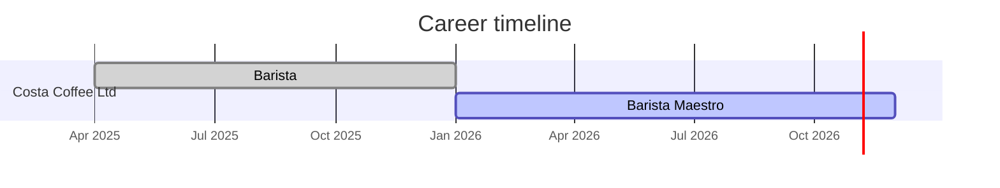
 
---

## Featured projects

## 1. Starbucks Nepal — Market-entry and affordability analysis

**Tools:** Excel · Strategic analysis · Macroeconomic researchStarbucks_img
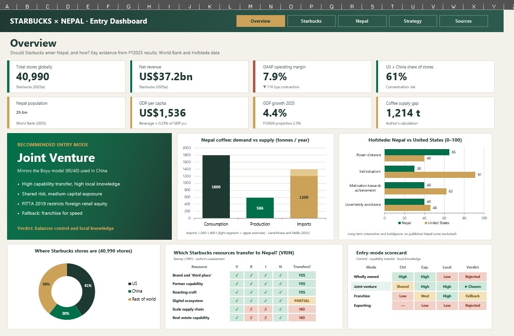

### Business question

How could Starbucks evaluate a potential Nepal entry while accounting for premium positioning, local market conditions and customer affordability?

### Key analytical finding

The available project evidence does not verify a monthly-income affordability estimate for Nepal or the United States.

The project workbook contains a separate GDP-per-capita proxy; this is not a measure of monthly individual or household affordability.

**Evidence status:** The original affordability calculations and supporting inputs could not be verified from the available project evidence. The headline corporate statistics below are externally verifiable from Starbucks filings (linked).

**Authoritative corporate sources (Starbucks FY2025):**
- [Starbucks FY2025 results (official press release)](https://investor.starbucks.com/news/financial-releases/news-details/2025/Starbucks-Reports-Q4-and-Full-Fiscal-Year-2025-Results/default.aspx)
- Starbucks FY2025 Form 10-K — consult the annual report for detailed disclosures.

The official FY2025 results report **40,990 stores** at fiscal year-end, **US$37.2 billion in consolidated net revenue**, and a **7.9% GAAP operating margin**, down **710 basis points year over year**. These are global corporate figures; they do not establish Nepal-specific demand, affordability or commercial viability.
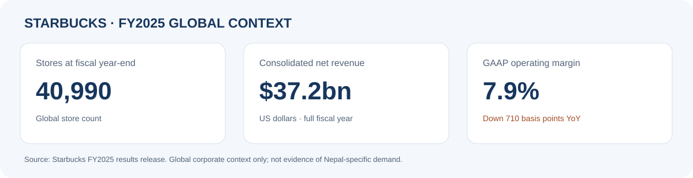

**Macroeconomic proxies:**
- Nepal GDP per capita (current US$) — World Bank / country data: https://data.worldbank.org/indicator/NY.GDP.PCAP.CD?locations=NP
- United States GDP per capita (current US$) — World Bank / country data: https://data.worldbank.org/indicator/NY.GDP.PCAP.CD?locations=US

> Note on income measures: GDP per capita, median household income, disposable income and individual wages are distinct measures. Affordability results depend strongly on which income measure is used; GDP per capita is a broad economic average and does not equal typical household or individual earnings.

### Affordability (current repository status)

| Location | Monthly affordability result | Evidence status |
|---|---|---|
| Nepal | Not reported | Original calculation and inputs not verified |
| United States | Not reported | Original calculation and inputs not verified |

*How to validate:* provide the original calculation model or a reproducible table listing each drink price, product size, location and date; currency and exchange-rate source; comparable monthly income measures and citations; and the calculation cells.

### Decision framework

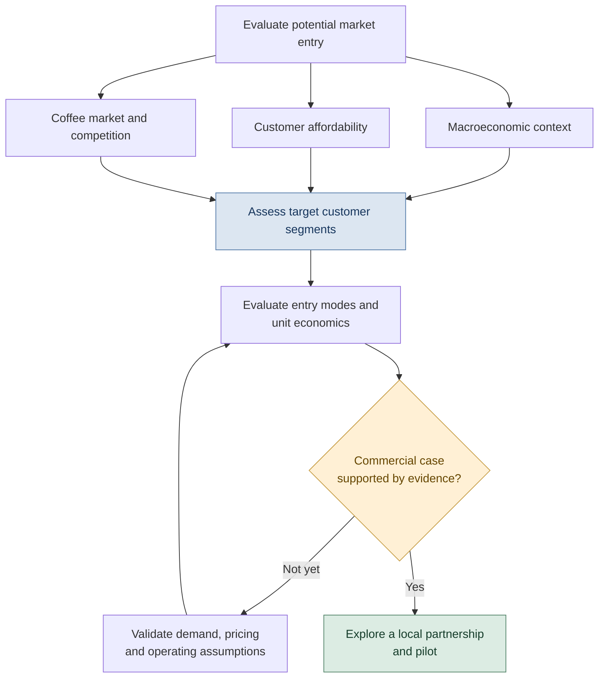

### Business implication

Affordability remains a question to validate for a premium coffee proposition. A local partnership may help evaluate market knowledge and operating fit, but this is a proposal to be tested rather than a concluded strategy.

**What this project demonstrates:** Market research, strategic reasoning and evidence-focused recommendations.

---

## 2. Sales Analytics — Historical performance and KPI analysis

**Tools:** Excel · PivotTables · Lookup functions

### Business question

How does performance vary over time and across product categories, and which changes deserve further investigation?

### Selected performance comparison

Earlier project notes list endpoint `Profit` values of **2.88 million (2011)** and **7.04 million (2016)**. These values remain under reconciliation with the raw-date grouping and cached pivot results; the source currency and formal definition of `Profit` have not been verified. No growth percentage is presented pending reconciliation.

**Evidence status:** The workbook is included in this repository as [Profit & Loss Dashboard project.xlsx](./Profit%20Loss%20Dashboard%20project.xlsx). Its cached annual summary does not fully reconcile with grouping raw records by actual date; source currency and the formal definition of `Profit` also remain unverified. See the [workbook data-quality audit](./workbook_data_quality_audit.md).

### Visual findings and statistical checks

**Product-category revenue share**

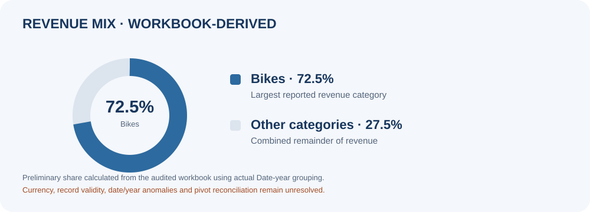

The workbook-derived grouping attributes approximately 72.5% of revenue to Bikes. Treat this as a preliminary category mix, not an independently validated financial result.

**Record distribution by the year in the Date field**

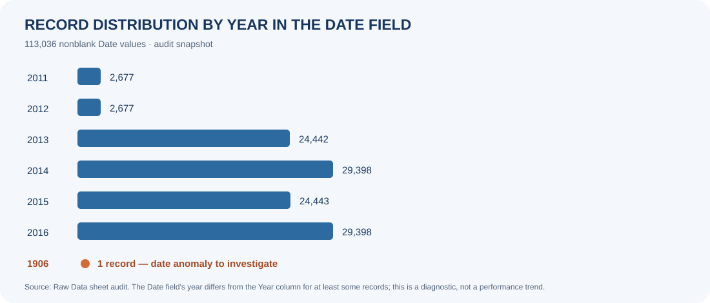

The audit found one record dated 1906 even though the dataset is presented as covering 2011–2016. This is a data-quality signal to investigate, not a business trend.

**IQR outlier screening**

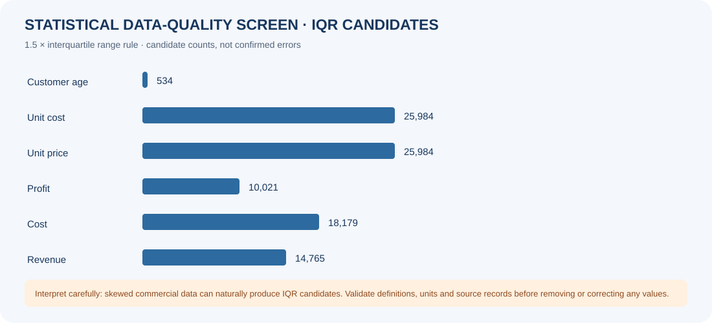

The 1.5 × IQR rule flags candidate observations in several numeric fields. These are screening candidates, not confirmed errors; commercial data can be skewed, so records should not be removed without contextual validation.

*How to validate:* confirm the source currency and profit definition, resolve date/year anomalies and repeated records against an authoritative source, and reconcile the annual pivot results to an approved aggregation basis in a separate working copy.

### Analytical workflow

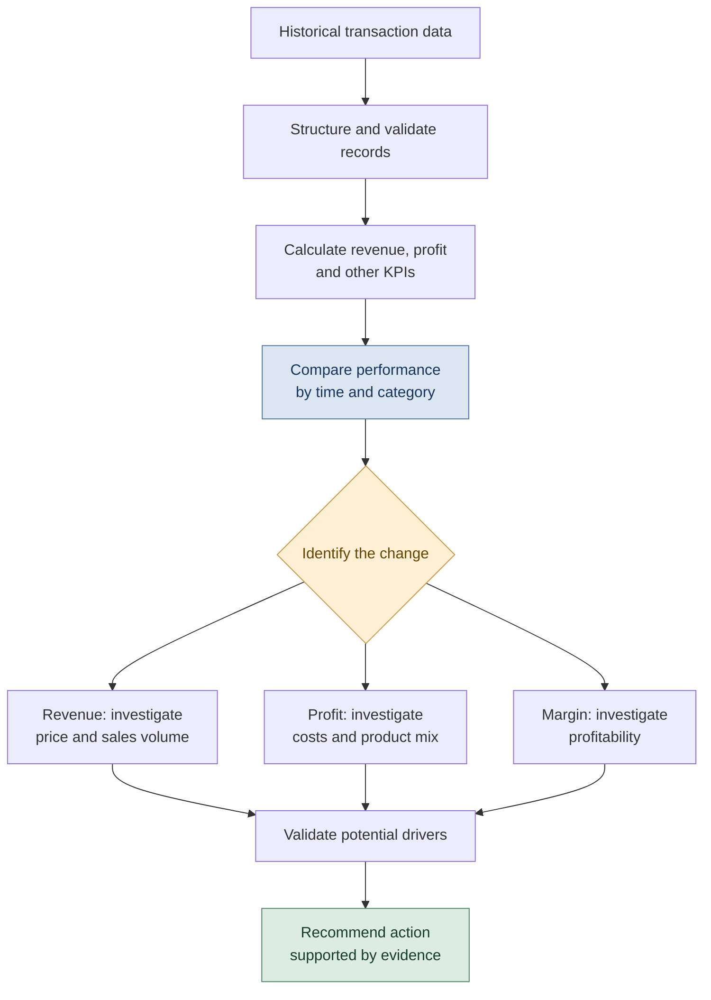

**What this project demonstrates:** Data preparation, KPI analysis, trend interpretation, dashboard reporting and commercial problem‑solving. The workbook is linked above in this repository, but its annual summaries and source definitions remain under review.

---

## 3. AI Agent Workflow — Authorisation and safety controls

**Focus:** Workflow design · Risk awareness · Process review

### Business question

How can an AI-assisted workflow distinguish permitted requests from unauthorised actions and make its control boundaries more explicit?

### Control design

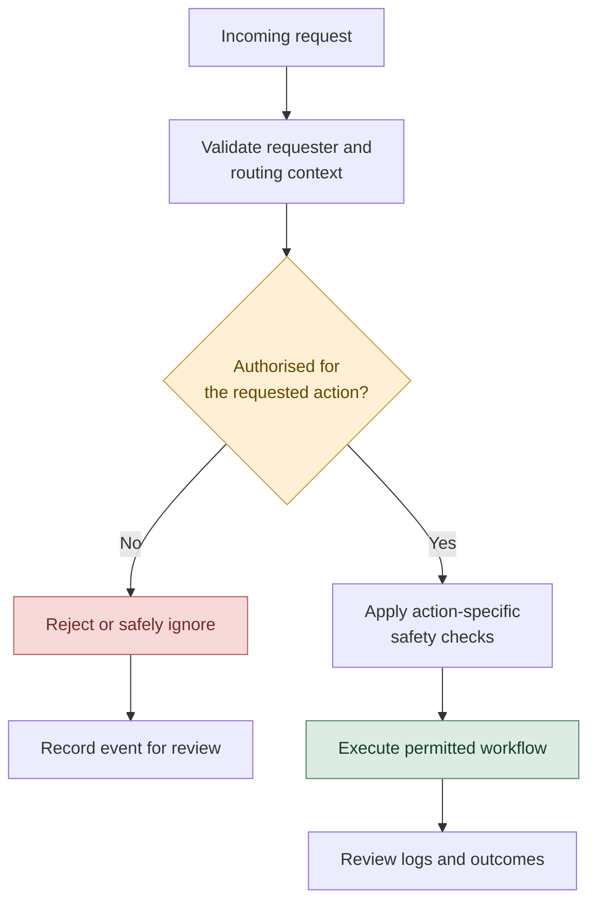

### Key insight

A workflow can function correctly under normal conditions and still contain an authorisation weakness. Access checks must be applied before protected actions, with appropriate logging and testing.

In my practical workflow exploration, I investigated an authorisation boundary issue and added a guard against unauthorised handling. The README now clarifies which parts are implemented and which are conceptual.

**What this project demonstrates:** Workflow reasoning, risk identification, control design and an interest in responsible AI adoption.

---

---

## 5. AI-Assisted Financial Forecasting — Walk-forward model review

**Tools and methods:** Quantcept historical market data · Claude-assisted reporting · Ridge regression · baseline comparison · chronological walk-forward evaluation

### Business question

Can a Ridge regression model improve on a simple baseline when forecasting the 20-trading-day price change across multiple instruments and unseen yearly test periods?

### Headline results

| Metric | Simple baseline | Ridge regression | Interpretation |
|---|---:|---:|---|
| Return MAE | 4.10% | 4.09% | Practically indistinguishable in the aggregate |
| Price MAE | 251.9635 | 251.6687 | Slightly lower reported error; units differ by instrument |
| Directional accuracy | 57.68% | 52.94% | Ridge trails the baseline on direction |

### Forecast error over time

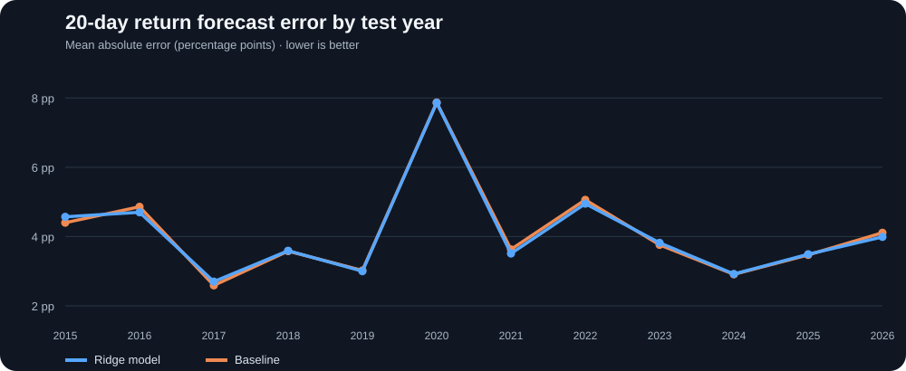

The error lines largely overlap, with both models' errors rising sharply in 2020. Ridge does not show a consistent, meaningful improvement over the baseline.

### Directional accuracy over time

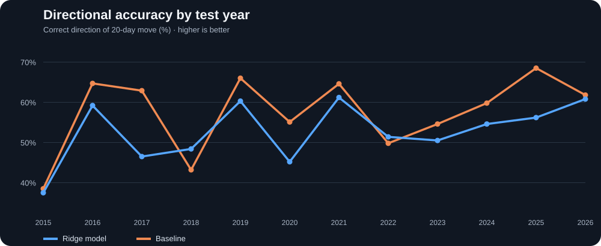

The model beats the baseline in only two test years in the report. Overall, Ridge's directional accuracy is lower than the baseline's, so the forecast should not be treated as a reliable market-direction signal.

### Latest forecast versus typical error

The reported forecast moves are small relative to typical model error. This weak signal-to-error comparison is another reason not to interpret these outputs as actionable trading recommendations.

### What I learned

- Why chronological splits and year-by-year walk-forward evaluation are important for time-series work.
- Why a model needs to be compared with a clearly defined baseline using the same test observations.
- Why numerical error and directional accuracy measure different aspects of forecast quality.
- How AI-assisted reporting can help communicate findings, while the analyst remains responsible for checking the metrics and limiting claims.

### Limitations and status

This is an **exploratory prototype**, not a validated trading strategy. The report's figures have not been independently audited. Further checks should verify target definitions and units, sample sizes, forecast/target alignment, overlapping horizons, treatment of corporate actions and dividends, the partial 2026 test period, and reproducibility of the evaluation. BP and Shell price series may use different adjustment conventions and are not directly comparable.

**Conclusion:** The current evaluation does not demonstrate a reliable predictive edge or investment profitability. This project demonstrates an analytical workflow and critical model evaluation—not investment advice.

**Full HTML report:** [Walk-Forward Forecast Review](./Walk-Forward-Forecast-Review.html) — the charts and key insights above are also visible directly in this README without opening the report.

## 4. Green Motion — Operations analysis and improvement proposal

**Focus:** Operations management · PDCA · Forecasting · Process analysis

### Business question

How can operational imbalances and potential forecasting weaknesses be investigated systematically?

### Improvement framework

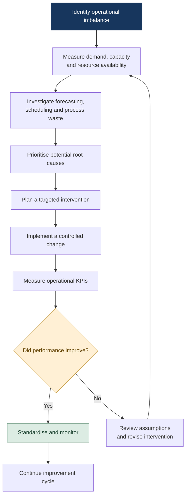

### Key insight

Frameworks such as PDCA, 4Vs and TIMWOODS can structure an operational investigation, but a framework alone does not demonstrate an improvement. The outcome should be evaluated through appropriate before/after KPIs.

Potential measures include utilisation, forecast error (e.g. MAPE), turnaround time and resource imbalance, depending on the data available.

**What this project demonstrates:** Operations analysis, structured problem-solving and the translation of business frameworks into practical improvement proposals. This coursework does not report a measured productivity improvement.

---

## Education

**BSc (Hons) Applied Management — BPP University**  
Expected completion: 2028

Relevant study areas include:

- Business Analytics
- International Business
- Operations Management
- Strategic Management
- Sustainability Management
- Organisational Behaviour
- Finance

---

## Professional experience

### Barista Maestro — Costa Coffee Ltd
**January 2026 – Present | Woking, Surrey**

- Monitor daily sales and product mix to support stock and staffing decisions.
- Identify operational issues and coordinate with colleagues to maintain service standards.
- Coach new team members on customer service, operational procedures and consistency.
- Support day-to-day decisions in a fast-paced customer-facing environment.
- Nominated for Costa Barista of the Year UK in 2026.

### Barista — Costa Coffee Ltd
**April 2025 – January 2026 | Woking, Surrey**

- Progressed to Barista Maestro within the first year.
- Developed experience in customer service, teamwork, operational consistency and handling competing priorities.

---

## What I bring to an analyst role

- A business-first approach to data and performance analysis.
- Experience connecting operational context with KPI reporting.
- A willingness to validate assumptions rather than overstate conclusions.
- Clear communication of findings, limitations and potential actions.
- A self-directed learning mindset across analytics, business intelligence and quantitative methods.

I am particularly interested in opportunities where I can combine analytical skills with business understanding, contribute to evidence-led decisions and develop through practical experience.

## Contact

- **Email:** [thakalidenil@gmail.com](mailto:thakalidenil@gmail.com)
- **LinkedIn:** [linkedin.com/in/subash-gauchan16](https://www.linkedin.com/in/subash-gauchan16/)
- **GitHub:** [github.com/denilthaks](https://github.com/denilthaks)
- **Location:** Woking, Surrey, United Kingdom

---

## Evidence and limitations

The project files included here do not verify every original calculation. The following checks remain necessary before the affected figures can support decisions:

1. **Starbucks Nepal:** Validate the original affordability model or provide a reproducible table listing drink price, product size, location/date, currency and exchange-rate source, comparable monthly income measures, citations and calculation cells. GDP per capita is a broad economic average, not a proxy for an individual's or household's monthly disposable income.
2. **Sales Analytics:** Confirm source currency, the definition of `Profit`, date treatment, repeated-row handling and aggregation logic; then reconcile cached pivot summaries against an approved calculation from the underlying records. Until then, do not use unreconciled sales trends to guide inventory or other operational decisions.

Monthly affordability estimates and sales growth percentages are withheld because their inputs or calculations have not been sufficiently verified. The preliminary 2011 and 2016 endpoint values, 37.8% Profit-to-Revenue ratio and 72.5% Bikes revenue share should be treated as workbook-derived exploratory results, not independently validated financial measures. In particular, the ratio is not labelled gross margin, and no source currency is assumed.

See the [workbook data-quality audit](./workbook_data_quality_audit.md) for the sales-data limitations. Starbucks FY2025 corporate metrics are linked in the project section above and describe the global business, not Nepal-specific market demand.

---

  Open to entry-level, graduate and internship opportunities in Data Analysis, Business Analysis, Business Intelligence, Operations Analysis and Research Analysis.

